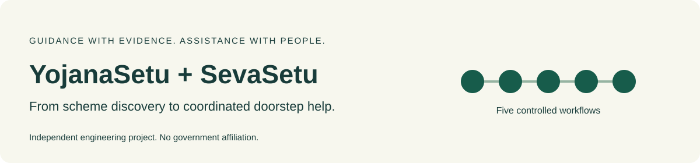
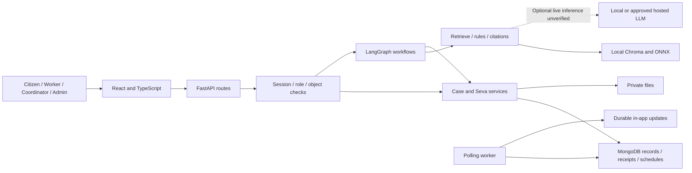
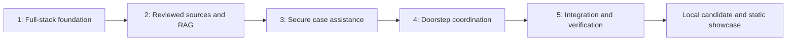
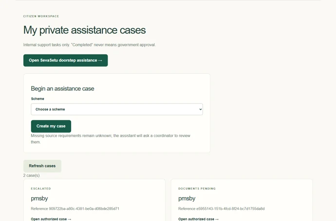
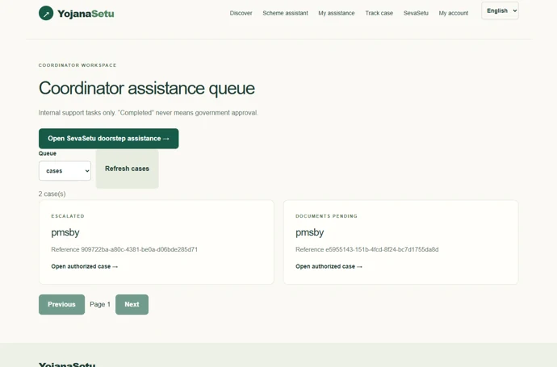
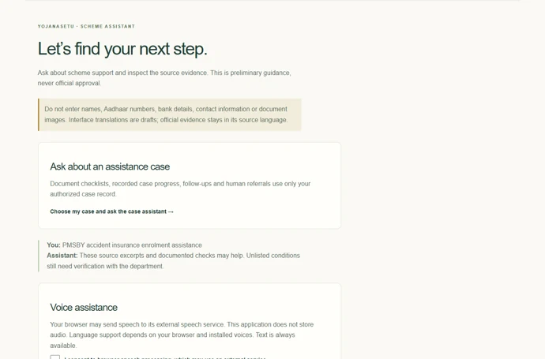
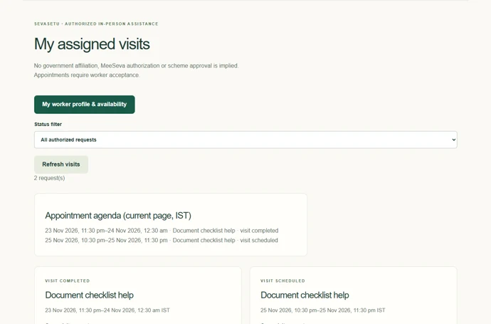
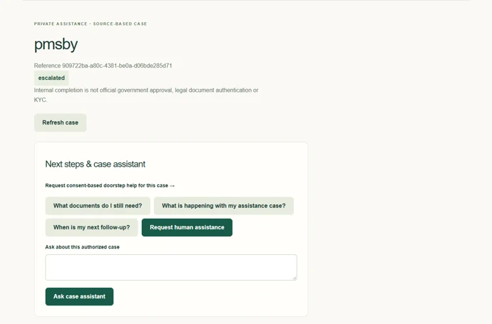
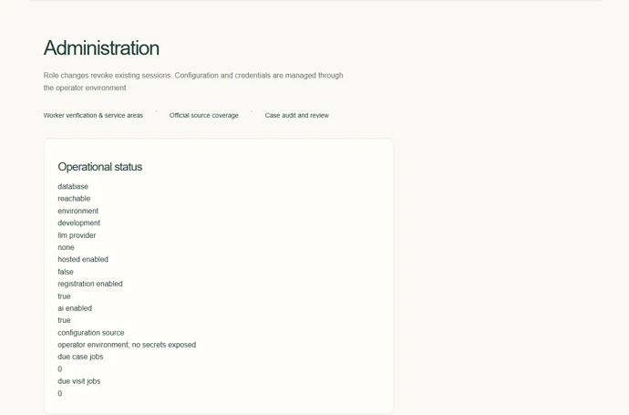

<p align="center"></p>

# YojanaSetu + SevaSetu

**Welfare information with traceable evidence. Human assistance with accountable workflows.**

YojanaSetu connects reviewed government-scheme information to private assistance cases. SevaSetu coordinates consent-based doorstep visits, internally verified workers and human-reviewed outcomes. This is an independent portfolio project with synthetic demonstration data, without government affiliation or measured citizen-impact claims.

     

**[Public interview showcase](https://dhroovs.github.io/YojanaSetu/)** | [GitHub](https://github.com/Dhroovs/YojanaSetu) | [Architecture](docs/ARCHITECTURE.md) | [Interview guide](docs/INTERVIEW_GUIDE.md) | [Quick revision](docs/QUICK_REVISION.md)

> **Actual status:** the public URL is a static showcase of real local screens, not a hosted backend. The complete platform runs locally. Recorded verification: **108 backend tests, 25 frontend tests, five browser suites**, and successful remote Linux container startup/restart/persistence checks. **Overall CI is red because Chroma dependency advisories remain unresolved.** Native speech, live LLM inference and external messaging remain unverified. [Exact evidence and dates](docs/FINAL_RELEASE_REPORT.md).

## The project in two minutes

**For recruiters:** a React/FastAPI platform combining source-backed retrieval with secure case and visit workflows. Key engineering work includes provenance checks, authorized agent handoffs, durable reminders and concurrent worker reservations. Humans retain authority over document review, assignment and completion.

**For beginners:** imagine someone seeking insurance-scheme guidance. They search the catalogue, ask a question and inspect its supporting official passages. They can create a private case, follow a source-backed checklist, upload a synthetic/redacted document, receive reminders and ask a coordinator for help. A linked visit can proceed through approval, assignment, acceptance, check-in, human outcome review and feedback.

The intended users include rural and elderly citizens, people with limited digital confidence, workers and coordinating organizations. Draft language support, accessible controls and human assistance address those needs. These are intended benefits; no field adoption, user counts or social-impact statistics have been established.

## Problem, solution and implementation

| Problem | Project response | Implementation |
| --- | --- | --- |
| Information is difficult to navigate | Search/filter discovery and source provenance | [React routes](frontend/src/main.tsx), [FastAPI](backend/app/main.py) |
| Fluent answers can hide missing evidence | Local retrieval, curated rules, citations and explicit unknowns | [SchemeMatcher](backend/app/agents/scheme_matcher.py) |
| Documents and tracking are confusing | Private checklists/files, human review and case timelines | [case service](backend/app/cases/service.py), [storage](backend/app/cases/storage.py) |
| Assistance loses continuity | Durable reminders and human referrals | [automation](backend/app/cases/automation.py) |
| Visits require coordination | Verified-worker eligibility and atomic reservations | [Seva service](backend/app/seva/service.py), [calendar store](backend/app/seva/store.py) |
| Language and accessibility create barriers | Draft hi/te UI, locale formatting and consented speech/text fallback | [language](frontend/src/language.tsx), [voice](frontend/src/voice.tsx) |

## Features and boundaries

| Area | Verified or implemented local scope | Boundary |
| --- | --- | --- |
| Citizen | Signup/login, discovery, matching/citations, private cases, checklist/upload, reminders/referrals, visits/tracking, notifications and feedback | Preliminary assistance; no government application submission or guaranteed eligibility |
| Worker | Login, profile/calendar, assigned visits, accept/decline, en-route/check-in, performed-service outcomes and visit follow-up actions | Current verification/assignment required; NGO volunteer is a worker profile kind |
| Coordinator | Owned queues, document reviews, follow-ups, referral acknowledgement/resolution, ranking, confirmed assignment and outcome review | Human approval remains explicit |
| Administrator | Users/roles/activation, worker verification/suspension, organizations/service areas and safe operations | Source writes/configuration are operator-only; account audit has no separate browser screen |
| AI workflows | Scheme Matcher and Doorstep graphs; deterministic Document, Follow-up and Escalation nodes | Five capabilities, not five independent autonomous LLMs; verified mode is evidence-only RAG |
| Languages/voice | English and draft Hindi/Telugu static dictionaries/preferences; speech consent, editable text and fallback | Native review, physical microphone/playback and multilingual semantic RAG not established |
| Messaging | Durable in-app updates, quiet hours, frequency, acknowledgement and replay protection | Twilio SMS/Meta WhatsApp adapters mock-tested, unconfigured and not automatically connected |

## System architecture



A button sends a validated HTTP request. FastAPI checks the current session, role and ownership before a service accesses data. Graphs call these same services. MongoDB stores operational records; Chroma stores public source vectors; private documents stay outside the public frontend root. The worker reads persisted due times, so closing a browser does not erase a reminder. [Detailed request traces](docs/ARCHITECTURE.md).

## Five development phases



| Phase | What connected to the previous work | Concepts and actual completion |
| --- | --- | --- |
| 1 | React/Vite, FastAPI, Mongo catalogue and initial case/doorstep intake | HTTP, components, validation, persistence. Historical foundation verified; later private flows supersede legacy development paths. |
| 2 | Reviewed HTML/PDF ingestion, embeddings, Chroma, graph, rules/citations and minimal conversation memory | Semantic retrieval, provenance and uncertainty. Local RAG verified; live model inference not established. |
| 3 | Individual sessions, role/object checks, private files, Document/Follow-up/Escalation and human queues | Privacy, durable jobs, CAS/idempotency. Integrated private workflows verified. |
| 4 | Current worker verification, area/language/category/availability checks, reservations and visit outcomes | Concurrency and human gates. Synthetic multi-role lifecycle verified. |
| 5 | Signup/admin, language/voice fallback, notices/adapters, source improvements, tests and container/CI setup | Reproducibility and release boundaries. Local candidate/container smoke verified; public backend release blocked. |

[Development lessons and Git history](docs/PROJECT_WALKTHROUGH.md#chapter-17-git-and-github).

## Real application screens

These screen excerpts came from the actual local platform using synthetic records. Select a thumbnail for the full capture. They do not establish real field visits or government approval.

| Citizen and evidence | Coordination and operations |
| --- | --- |
| [](docs/demo-evidence/03-citizen-dashboard.png) | [](docs/demo-evidence/09-coordinator-dashboard.png) |
| [](docs/demo-evidence/04-scheme-matcher.png) | [](docs/demo-evidence/11-worker-dashboard.png) |
| [](docs/demo-evidence/05-document-assistance.png) | [](docs/demo-evidence/13-administrator-dashboard.png) |

<details>
<summary>More real screenshots</summary>

[Homepage](docs/demo-evidence/01-homepage.png) | [Login](docs/demo-evidence/02-citizen-login.png) | [Case tracking](docs/demo-evidence/06-case-tracking.png) | [Booking](docs/demo-evidence/07-sevasetu-booking.png) | [Appointment](docs/demo-evidence/08-appointment-tracking.png) | [Worker calendar](docs/demo-evidence/12-worker-calendar.png) | [Internal verification](docs/demo-evidence/14-worker-verification.png) | [Sources](docs/demo-evidence/15-source-provenance.png) | [Reviewed simulated completion](docs/demo-evidence/16-reviewed-completion.png) | [Scheme discovery](docs/demo-evidence/17-scheme-discovery.png) | [Hindi UI](docs/demo-evidence/18-hindi-discovery.png) | [Telugu mobile](docs/demo-evidence/19-telugu-mobile.png)

</details>

## Technology choices

| Technology | Responsibility | Source starting point |
| --- | --- | --- |
| React 18, TypeScript, React Router, Vite | Components, typed forms, routing and build | [main.tsx](frontend/src/main.tsx) |
| Tailwind CSS and custom CSS | Base/utilities, layout, focus and responsive design | [styles.css](frontend/src/styles.css) |
| Python 3.12, FastAPI, Pydantic | Validated REST requests and service boundaries | [main.py](backend/app/main.py), [models](backend/app/cases/models.py) |
| Async PyMongo and MongoDB | Users, opaque sessions, cases, visits, calendars, audit/jobs | [CaseStore](backend/app/cases/store.py) |
| Chroma and ONNX MiniLM | Public vectors and cosine retrieval | [VectorIndex](backend/app/ai/vectors.py), [providers](backend/app/ai/providers.py) |
| LangGraph | Typed finite workflows and conditional routing | [agents](backend/app/agents) |
| PyMuPDF, BeautifulSoup, HTTPX | PDF/HTML extraction, file checks and provider transport | [ingestion](backend/app/ai/ingestion.py) |
| Pytest, Vitest, Testing Library, Playwright | Service/UI/Mongo/concurrency/browser tests | [tests](backend/tests), [browser scripts](backend/scripts) |
| Docker Compose, Nginx, GitHub Actions | Four-service rehearsal, proxy and quality/security gates | [compose](compose.yaml), [CI](.github/workflows/ci.yml) |

Comparative reasons such as FastAPI's convenient typed request boundary are retrospective engineering explanations unless a historical record explicitly states otherwise. [Full rationale and source reading map](docs/PROJECT_WALKTHROUGH.md).

## Run locally

Follow [the beginner Windows guide](docs/LOCAL_SETUP_WINDOWS.md) for fresh cloning, software, Mongo, .env, reviewed-source ingestion, staff provisioning, startup, tests and troubleshooting. Evidence-only mode needs no paid model API.

For an existing configured checkout, start Mongo first and use separate PowerShell terminals:

```powershell
Set-Location E:\YojanaSetu\YojanaSetu\backend
.\.venv\Scripts\python.exe -m uvicorn app.main:app --host 127.0.0.1 --port 8000 --no-access-log
# Separate terminal in backend:
.\.venv\Scripts\python.exe -m app.cases.worker
# Separate terminal in frontend:
npm run dev
```

Open **http://localhost:5173/** and **http://127.0.0.1:8000/docs** on the development PC. If the isolated inspection demo already uses those ports, inspect it rather than launching competing servers. [Safe local demo access](docs/LOCAL_DEMO_ACCESS.md) uses randomly generated, Windows-encrypted credentials. No password or actual demo video is published here.

## Verification and deployment

| Recorded check | Observed result, not a coverage claim |
| --- | --- |
| Windows backend, 23 November 2026 | 108 passed, 0 failed/skipped, 155.43s |
| Frontend, 23 November 2026 | 25 tests across 9 files; lint/typecheck/production build passed |
| Chrome | Five regressions and 16 persistent-demo captures passed with zero JS errors |
| Linux CI, 24 November 2026 | 108 passed in 27.71s; frontend and container runtime jobs passed |
| Security | 119 pinned Python packages scanned, unresolved Chroma findings keep overall CI red; npm audit reported 0 vulnerabilities at verification |
| Public URL | HTTPS GitHub Pages static showcase only, without data entry/API/backend hosting |

Container testing caught a proxy recovery problem; the fix refreshes Docker DNS and verifies data across restart/container replacement. No user counts, accuracy percentages or performance gains are invented. [Release evidence](docs/FINAL_RELEASE_REPORT.md) | [Tests](docs/TESTING.md) | [Strictly free hosting review](docs/FREE_HOSTING_REVIEW.md).

## Learning and interview centre

| Guide | Purpose |
| --- | --- |
| [Complete walkthrough](docs/PROJECT_WALKTHROUGH.md) | Twenty chapters from basics to project implementation |
| [Architecture](docs/ARCHITECTURE.md) | Data boundaries, optional services and request traces |
| [Five agents](docs/AGENTS.md) | Analogies, exact nodes/classes, inputs/outputs and human gates |
| [RAG pipeline](docs/RAG_PIPELINE.md) | Ingestion, vectors, provenance and PMSBY example |
| [API reference](docs/API_REFERENCE.md) | Actual routes, roles and sanitized examples |
| [Database](docs/DATABASE.md) | Collections, ownership, atomicity and recovery |
| [Security](docs/SECURITY.md) | Sessions, roles, file privacy, consent and remaining risks |
| [SevaSetu](docs/SEVASETU_WORKFLOW.md) | Eligibility, ranking, lifecycle and concurrency |
| [Local setup](docs/LOCAL_SETUP_WINDOWS.md) | PowerShell instructions and troubleshooting |
| [Deployment](docs/DEPLOYMENT.md) | Containers versus actual static publication |
| [Testing](docs/TESTING.md) | Test meanings, commands and evidence |
| [Interview guide](docs/INTERVIEW_GUIDE.md) | Introductions and 110 project-specific Q&As |
| [Quick revision](docs/QUICK_REVISION.md) | Five-minute and 15-20-minute revision |
| [Presentation](docs/PROJECT_PRESENTATION.md) | 22 slides, notes, [PDF](presentations/YojanaSetu-SevaSetu.pdf) and [editable HTML](presentations/YojanaSetu-SevaSetu.html) |
| [Demo script](docs/DEMO_SCRIPT.md) | Three-, five-, ten-minute and full walkthroughs |
| [Portfolio guide](docs/PORTFOLIO_GUIDE.md) | Honest resume, LinkedIn and portfolio copy |
| [Glossary](docs/GLOSSARY.md) | Plain-English terms with project examples |
| [Limitations](docs/KNOWN_LIMITATIONS.md) | Source/model/language/security/hosting boundaries |
| [Release report](docs/FINAL_RELEASE_REPORT.md) | Executed results, dates, commits and URLs |
| [Documentation QA](docs/DOCUMENTATION_QUALITY.md) | Link, diagram, API, screenshot and presentation checks |

Study README, then walkthrough, architecture, agents/RAG, security/SevaSetu, interview guide and quick revision. Open the source as you study. Explain AI-assisted development honestly rather than claiming manual authorship of every line.

## Limits and licensing

Coverage is three schemes/four partial reviewed sources. Eligibility may remain unknown. Live LLMs, native speech, SMS/WhatsApp delivery, account recovery/MFA, native translation review and production scale/recovery certification remain outside verified completion. Resolve the Chroma gate before public backend release. Static hosting cannot supply this persistent native stack and worker.

No project license has been selected. Public visibility is not an open-source license grant. Third-party software and government materials retain their own terms. Choosing a license requires the owner's approval.
