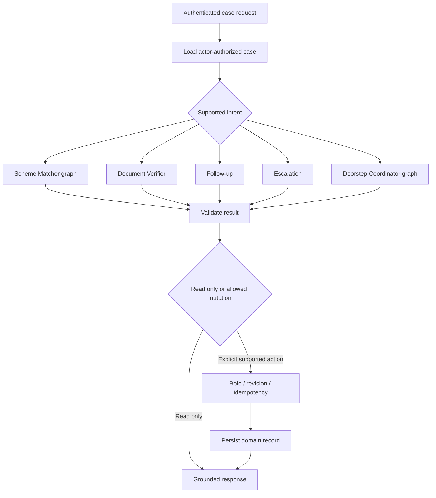
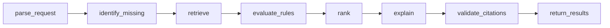
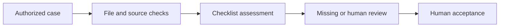
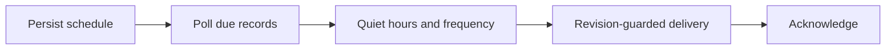
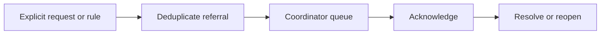
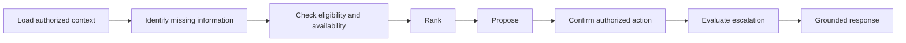

# Five controlled assistance capabilities

The project has five domain capabilities, not five autonomous language models. Scheme Matcher and
Doorstep Coordinator have bounded LangGraph workflows. Document, Follow-up and Escalation execute
as deterministic tasks in CaseOrchestrator. StateGraph coordinates the work; backend services retain authority.



## 1. Scheme Matcher

**Analogy:** A reference librarian who cites passages instead of inventing policy.

**Inputs:** Question, minimal optional profile, scope, session-owned previous scheme IDs, active reviewed source chunks.

**Outputs:** Structured recommendations with condition outcomes, evidence, warnings, missing questions, conversation ID and model usage when reported.



**How it works:** Optional LLM query rewrite/excerpt selection, plus deterministic retrieval/rules/citation gates. Verified mode uses local ONNX retrieval with no live LLM.

**Example input:** PMSBY accident insurance enrolment assistance, age optionally supplied.

**Expected interpretation:** Relevant PMSBY evidence may be returned, but partial or unreconciled sources keep eligibility unknown. This is a sanitized teaching example, not an invented execution trace.

**Controls and limits:** Active source hash/version checks, relevance threshold, missing/stale evidence warnings, bounded provider failure/fallback and output validation. No arbitrary tools or official application submission.

**Implementation:** [backend/app/agents/scheme_matcher.py](../backend/app/agents/scheme_matcher.py). Important symbols: `SchemeMatcher; evaluate; citation; MatcherService.match`.

**Interview prompts:** Why can a relevant result remain unknown? How do citations survive source updates?

## 2. Document Verifier

**Analogy:** A checklist assistant at a review desk, not an identity-certification officer.

**Inputs:** Authorized case, source-backed checklist, unexpired/nondeleted uploaded-document metadata and technical review results.

**Outputs:** Items and statuses, missing item IDs, review readiness and next action.



**How it works:** Deterministic. Storage validates files and technical readability; optional OCR depends on Tesseract/configuration. No generative authenticity decision.

**Example input:** One checklist item has a readable synthetic PDF with review_status needs_human_review.

**Expected interpretation:** The item is present but not accepted_for_assistance_checklist; a coordinator must review it. This is a sanitized teaching example, not an invented execution trace.

**Controls and limits:** Private storage keys, access checks before bytes, limits/signature checks and retention. Readability is not authenticity, legal validity, malware certification or KYC.

**Implementation:** [backend/app/agents/case_agents.py](../backend/app/agents/case_agents.py). Important symbols: `DocumentVerifier.analyze; CaseService.upload; CaseService.review; inspect_document`.

**Interview prompts:** Who accepts a checklist item? What happens when OCR or source requirements are unavailable?

## 3. Follow-up

**Analogy:** A diary clerk who preserves appointments and reminders across shifts.

**Inputs:** Persisted followups, reminder identities, preferences, current time and relevant case state.

**Outputs:** Next follow-up, unacknowledged reminder IDs and internal next action; worker can persist delivery.



**How it works:** Deterministic scheduling and delivery rules. A language model is not needed to decide a due time.

**Example input:** A manual reminder is due while the browser is closed.

**Expected interpretation:** The running worker creates a durable reminder; a later session can acknowledge it. This is a sanitized teaching example, not an invented execution trace.

**Controls and limits:** Asia/Kolkata quiet hours, frequency limits, reminder/follow-up identity and CAS prevent winning duplicate state. Downtime delays processing until a worker resumes; no external exactly-once delivery promise.

**Implementation:** [backend/app/cases/automation.py](../backend/app/cases/automation.py). Important symbols: `FollowUpAgent.analyze; next_allowed; cases.automation.process_due; cases.worker.run`.

**Interview prompts:** Why use Mongo jobs rather than browser timers? What is durable versus exactly-once?

## 4. Escalation

**Analogy:** A referral desk that sends unresolved work to an accountable person.

**Inputs:** Case status/activity, explicit human-help request, missing-item reminders, review age and conflict flags.

**Outputs:** Configured trigger reasons/severity, internal referral and human resolution state.



**How it works:** Deterministic. CaseOrchestrator may persist a supported explicit request when apply_changes is true.

**Example input:** A citizen requests human assistance with a private case.

**Expected interpretation:** An internal human_assistance_requested referral becomes visible to the responsible coordinator. This is a sanitized teaching example, not an invented execution trace.

**Controls and limits:** Terminal cases stop rule escalation; authorized ownership/notes govern acknowledgement, resolution and reopening. It is not a government grievance API or autonomous department contact.

**Implementation:** [backend/app/agents/case_agents.py](../backend/app/agents/case_agents.py). Important symbols: `EscalationAgent.analyze; CaseService.escalate; escalation_action`.

**Interview prompts:** Which triggers are high severity? What resumes after all referrals are resolved?

## 5. Doorstep Service Coordinator

**Analogy:** A visit planner who proposes eligible staff and waits for human confirmation.

**Inputs:** Authorized visit, linked case owner, consent, category/language/location, worker accounts/verification/calendars, optional confirmed assignment body.

**Outputs:** Ranked eligible shortlist, missing information, human-approval flag, state-grounded next action and optional applied booking.



**How it works:** Deterministic eligibility/ranking/mutation gates; optional bounded grounded language summary. Ranking is workload then worker ID, not a learned model.

**Example input:** A consented document-assistance request matches a currently verified worker in its district and time window.

**Expected interpretation:** A proposal does not confirm the appointment until coordinator assignment and worker acceptance succeed. This is a sanitized teaching example, not an invented execution trace.

**Controls and limits:** Rechecks account/role/expiry/category/language/area/capability/organization/capacity/overlap. Atomic calendar reservation and booking revision protect concurrent actions. No government certification or travel-time routing.

**Implementation:** [backend/app/agents/doorstep_coordinator.py](../backend/app/agents/doorstep_coordinator.py). Important symbols: `DoorstepCoordinator; SevaService.candidates; assign; SevaStore.reserve`.

**Interview prompts:** Can a worker be selected from a stale shortlist? What if none is eligible?

## LangGraph from concepts to code

A graph is a named flowchart of work. A node is a function, an edge is the next step and a conditional
edge chooses one supported branch. State carries the request context. Human-in-the-loop here means
service-level confirmed actions and persisted review records, not a configured interrupt/checkpoint inbox.
A handoff calls a fixed collaborator after loading authorized context; it is not unrestricted inter-agent messaging.

The following exact fragment is from CaseOrchestrator.__init__:

```python
        graph.add_edge(START, "identify_intent")
        graph.add_edge("identify_intent", "load_context")
        graph.add_conditional_edges(
            "load_context",
            lambda s: s["intent"],
```

Line1 picks the first named task. Line2 loads context after intent classification. Line3 declares a
conditional transition. Line4 names its source node. Line5 reads the supported intent from state;
the mapping immediately below in source lists the permitted branch names. It cannot name arbitrary tools.

```python
        graph.add_edge("validate_result", "persist")
        graph.add_edge("persist", "respond")
        graph.add_edge("respond", END)
        self.graph = graph.compile()
```

These lines enforce validation before the persistence task, response after that task and explicit
termination. compile builds the executable graph. No checkpointer/saver is passed. Persist itself
may be a read-only no-op depending on the intent/body; a graph edge does not imply permission to mutate.

The step helper returns changed state fields and a trace entry; runtime state is ephemeral. Durable
cases/visits, receipts, audit, notices, jobs and minimal session-owned matcher memory survive separately.
Retries use bounded provider limits and domain idempotency/revisions, not an infinite agent loop.
Optional LangSmith tracing is explicitly disabled around citizen-context graph calls.

Read [the 110 interview answers](INTERVIEW_GUIDE.md), [RAG](RAG_PIPELINE.md) and
[the lifecycle](SEVASETU_WORKFLOW.md). Verified multi-capability browser evidence is in
[the release report](FINAL_RELEASE_REPORT.md); no live model claim follows merely from graph execution.
