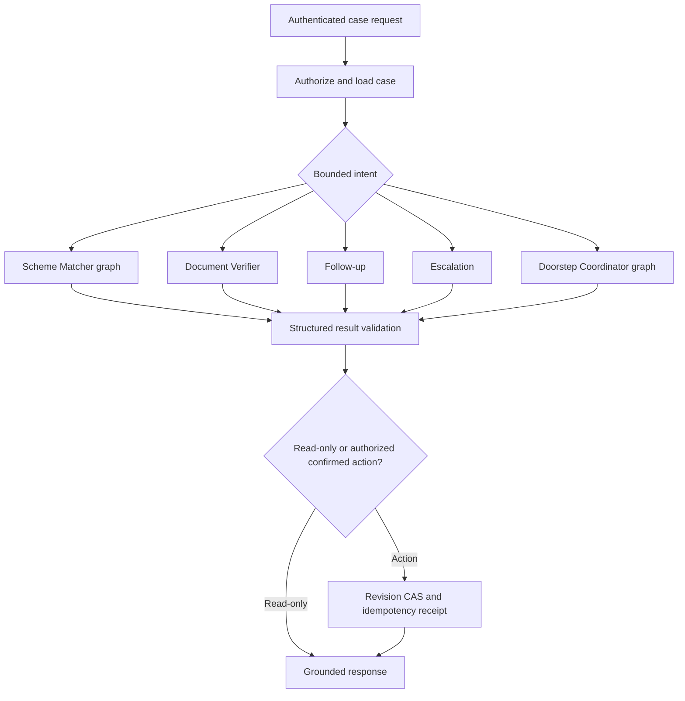

# Five controlled assistance agents

The application uses LangGraph for explicit typed state transitions, not autonomous
government decision making. The relevant implementations are in `backend/app/agents`.

| Agent | Inputs and evidence | Permitted result / human gate |
| --- | --- | --- |
| Scheme Matcher | Question, minimal profile, active reviewed source chunks and curated rules | Citation-checked preliminary guidance, missing questions and session-owned follow-up memory; no applications or approval |
| Document Verifier | Authorized case checklist and local technical file results | Missing/readable/uncertain items; human acceptance remains required; no identity authenticity or KYC |
| Follow-up | Authorized milestones, durable schedules and preferences | Internal reminders; quiet hours, frequency and acknowledgement; polling worker required |
| Escalation | Configurable inactivity, missing items, unresolved review or explicit request | Deduplicated internal human referral; authorized acknowledgement, resolution and reopening |
| Doorstep Coordinator | Authorized request/case link, consent, current worker profiles and calendars | Eligible ranked shortlist and proposals; coordinator confirms assignment, worker accepts, coordinator reviews outcome |

Document, follow-up and escalation tasks are deterministic nodes inside the case
orchestrator. They are not each independent model-driven graphs. Scheme Matcher and
Doorstep Coordinator have their own bounded graphs. There are no circular agent calls.
Typed graph state is ephemeral; durable cases, visits, receipts, audit, schedules and
the completion outbox preserve domain state for safe retries. No raw prompt/transcript
checkpoint is persisted. Model inference has bounded timeouts/retries and cannot choose tools.

The Phase 5 browser scenario uses one registered citizen, actual PMSBY evidence,
a PDF-backed checklist, document upload, document/follow-up/escalation/matcher requests,
and a linked doorstep request. Other role browser tests verify the coordinator/worker
completion path. Tests use synthetic citizen details. See [TESTING.md](TESTING.md).
