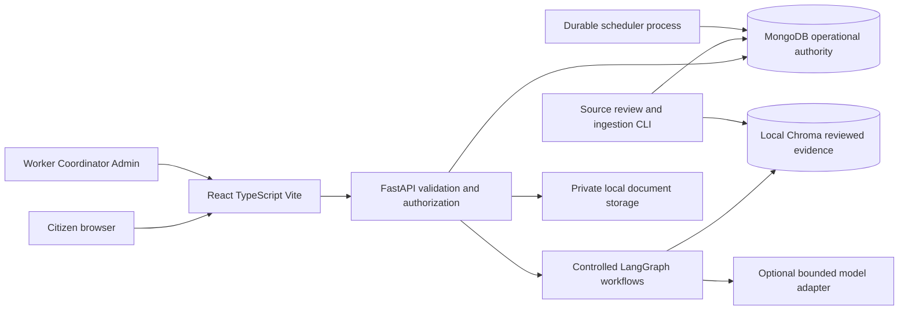
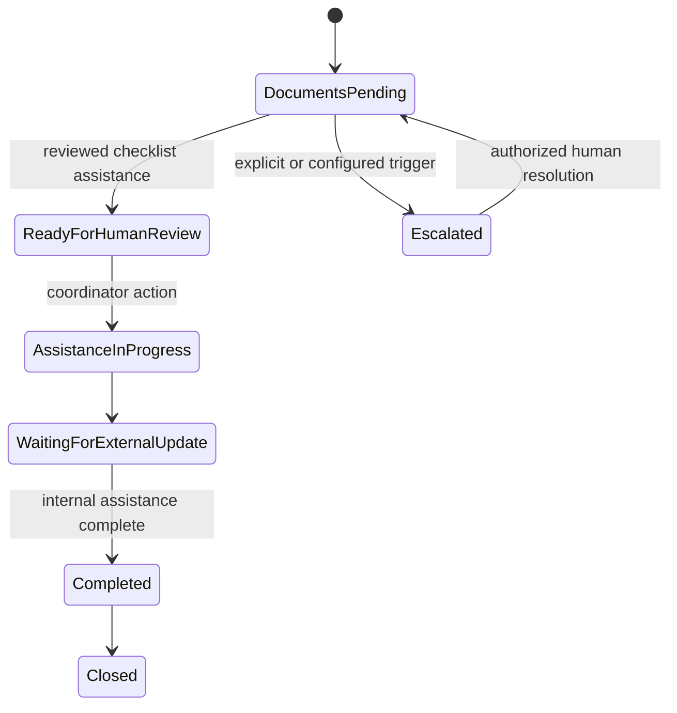

# Current architecture - Phase 5 local candidate

This document replaces the historical Phase 1 architecture. Earlier Git commits and
phase reports preserve that history. See FINAL_HANDOFF.md for observed results and
SECURITY.md for the unresolved production dependency gate.

Public discovery/source coverage is separate from private cases/visits. Individual
opaque bearer sessions authorize matching, profiles, case records and staff actions.
The legacy shared-development-token routes remain disabled in production. Public
signup creates citizen accounts only; operators/admins control staff roles.

MongoDB stores users, sessions, source metadata, minimal conversation state, private
case references, schedules/notices, visits, calendars and audit/receipts. Chroma stores
public reviewed text/vectors only. It is an embedded PersistentClient, not a Chroma
HTTP service. Private files are never mounted as public web assets.

Five bounded agent tasks route through typed LangGraph state. Deterministic rules
control eligibility and assignments; human review gates consequential actions.
Receipts/CAS and durable domain records provide retry state rather than raw prompt
checkpoints. A completion outbox connects a reviewed visit to authorized case activity.

Case and SevaSetu visit states are distinct; neither is a government department's
approval. Document checks address format/readability and internal checklist review,
not authenticity or legal KYC. Notifications are generic and durable, with preferences,
India-time quiet hours, deduplication and acknowledgement.

Static English/Hindi/Telugu dictionaries and device/account language preferences are
implemented. Official evidence is preserved in its source language. Browser speech
requires consent and offers editable text fallback; native speech remains unverified.
Optional models and external messaging are disabled until configured and approved.

Deployment manifests separate frontend proxy, backend, Mongo and worker, with named
storage and health ordering. Docker/remote CI were not executed here. The app is a
local candidate with explicit gates, not a production-certified or deployed service.

Detailed references: AGENTS.md, RAG_PIPELINE.md, SEVASETU_WORKFLOW.md, DATABASE.md,
API_REFERENCE.md, SECURITY.md, DEPLOYMENT.md and TESTING.md.
