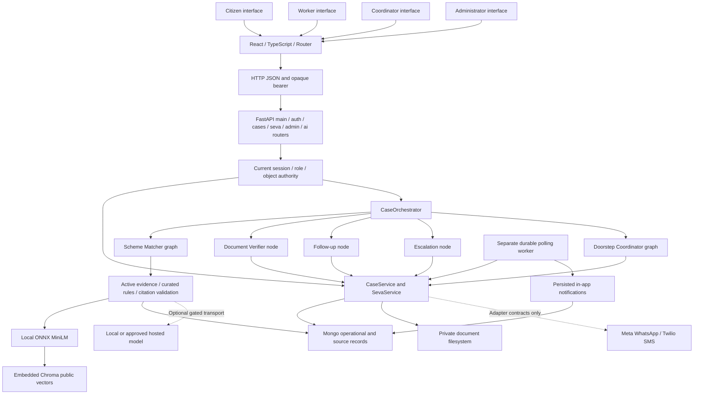

# System architecture and request flow

The full application is a local integrated platform. The public [showcase](https://dhroovs.github.io/YojanaSetu/)
serves static evidence only. Diagram arrows below describe implementation calls/data access, not a deployed
cloud topology. Dotted integrations are optional/unconfigured; live inference and external delivery are unverified.



## Plain-English responsibilities

React presents forms and requests current data. TypeScript catches many development-time mistakes, but the
server still validates every request. FastAPI dependencies resolve the current actor. Services enforce who may
read/change a case or visit, which transitions are legal and what confirmations are required. Stores implement
exact queries and revision/calendar authority. A graph coordinates tasks through those boundaries, not around them.

Mongo holds users, hashed sessions, cases, visits, worker calendars, source metadata, audit, receipts and jobs.
Chroma holds public source chunks/vectors, not private citizen uploads. File storage keeps bytes outside the
public frontend tree. A separate worker polls persisted schedules rather than relying on browser timers.
There is no Redis/Celery/Kubernetes/JWT service hidden in the architecture.

## A real request path: create a private case

1. `PrivateDashboard` in [private-cases.tsx](../frontend/src/private-cases.tsx) submits a selected scheme and assistance type.
2. [privateApi](../frontend/src/auth.tsx) sends POST, JSON, bearer and Idempotency-Key to `/api/cases`.
3. [main.py](../backend/app/main.py) takes the authenticated path, resolves the actor and calls `CaseService.create`.
4. [CaseService](../backend/app/cases/service.py) requires citizen role, derives ownership from the actor and creates the source-backed checklist.
5. [CaseStore](../backend/app/cases/store.py) inserts the record. Its unique owner/creation-key index governs replay; changed-payload reuse fails.
6. The response returns a case ID/revision/checklist. React renders the actual returned record; it does not manufacture a success card.

Sanitized teaching request, not a credential or captured citizen record:

```http
POST /api/cases
Authorization: Bearer <session-token>
Idempotency-Key: <new-random-key>
Content-Type: application/json

{"scheme_id":"pmsby","assistance_type":"Document checklist help"}
```

The response includes fields such as `id`, `owner_id`, `scheme_id`, `revision`, `stage` and `checklist`.
Read [the API examples](API_REFERENCE.md) for abridged JSON and role boundaries.

## Two other interactions

**Ask the matcher:** Assistant sends the minimal question/profile plus an independent session key. The AI
service owns bounded per-conversation work, merges explicit profile corrections and invokes SchemeMatcher.
The vector index retrieves active verified chunks. Curated rules and citation validation produce structured
preliminary guidance. The verified mode does not call a live LLM. Minimal profile/scheme IDs can persist with TTL;
raw prompts and full answers are not retained as conversation history.

**Request a doorstep visit:** the citizen submits a structured category/location/window with consent. The
coordinator claims/reviews the request. Candidate ranking is deterministic, while the assignment service rechecks
eligibility and atomically reserves one worker calendar. The worker accepts before a confirmed appointment;
check-in and outcome submission have stage/time guards. Coordinator completion review can enqueue an idempotent
case activity update. A visit reference never grants unrestricted access to its linked case.

## State and failure boundaries

| State | Authority / lifetime | Failure behavior |
| --- | --- | --- |
| Form/loading/error | React component state | Reload can discard it; fetch authoritative records again |
| Login | Opaque session hash in Mongo, token in tab memory | Runtime expiry, logout and auth_version revoke access |
| Graph context/trace | Typed per-invocation state | No configured LangGraph saver; reload domain state on retry |
| Case/visit/audit/receipts | Mongo record with revision | Stale writes fail409; receipts distinguish replay from changed payload |
| Worker reservation | Atomic seva_workers calendar document | Conflicting reservations fail; standalone multi-record recovery is conservative |
| Follow-up/notice/outbox | Persisted due/state data | Worker downtime delays processing; retries inspect authoritative state |
| Public evidence | Source hash/version plus Chroma vectors | Inactive/mismatched sources are rejected; partial/stale evidence stays uncertain |

## Runtime and operations

Native Windows uses loopback Mongo, FastAPI8000, Vite5173 and a separate worker. Local Compose uses Mongo,
backend, worker and Nginx frontend8080, with named private/vector/data volumes and no public Mongo port.
Remote Linux CI verified startup, proxy/auth and restart/replacement persistence with synthetic vectors/files.
Docker is absent locally. Fresh-container official-source RAG/model setup and a complete production restore are
not certified. [Deployment](DEPLOYMENT.md), [database](DATABASE.md), [security](SECURITY.md) and
[the release report](FINAL_RELEASE_REPORT.md) define the current limits.
