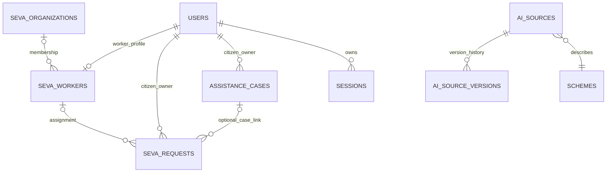

# Persistence, integrity and recovery

MongoDB holds users, hashed sessions, official catalogue/source metadata, minimal
conversation memory, cases, visits, worker calendars, organizations and admission
counters. Chroma holds only public reviewed text/vectors. Private documents are local
files referenced by random server-generated keys outside the frontend's public root.

Unique indexes protect user alias/ID, session hash, case/visit ID and owner creation
idempotency key, worker/organization IDs and source versions. TTL indexes clean expired
sessions, conversation memory and admission buckets. Runtime session expiry is checked
independently of delayed TTL cleanup. User role/activation is reloaded on each request;
`auth_version` invalidates old sessions after administrator changes.

Case and visit mutations use revision compare-and-swap plus receipts. One atomic
worker calendar update checks verification revision, expiry, capacity and overlap.
Audit notices and operation receipts are persisted with the winning case/visit CAS.
Completion outbox retries cannot duplicate case activity. Array/audit capacities and
query caps are bounded; larger production workloads require further scaling work.

Phase 5 changes are additive: new records get fields; old records use Pydantic defaults.
Existing missing user revisions are treated as zero on the first guarded update.
No destructive migration or real citizen data deletion was performed. Startup/readiness
initializes indexes; duplicate legacy data fails visibly rather than being silently removed.

## Backup and restore

Stop backend, scheduler and ingestion writers first. Keep MongoDB available for the
logical export. The operator CLI exports EJSON, indexes, private files and Chroma files
from a **quiesced** installation. It is not a concurrent distributed snapshot. Backups
contain sensitive hashes/documents: restrict access, encrypt offline storage, and do
not commit them. Sessions and transient admission records are excluded.

From backend, with a new backup directory:

```powershell
.\.venv\Scripts\python.exe -m scripts.backup backup ../backups/phase5-snapshot --confirm-quiesced
.\.venv\Scripts\python.exe -m scripts.backup restore ../backups/phase5-snapshot --target-database yojanasetu_restore_review --files-root ../backups/restored-files --confirm-quiesced
```

Restore refuses the original or a nonempty target database and an existing files root.
It checks collection hashes and counts, restores indexes and files, and never overwrites
the running database. A partial failure leaves the new target for investigation; use
a different new target after correcting the problem. Point an isolated backend to the
restored database/private/chroma paths, verify counts, ownership, file access and actual
vector retrieval, then authorize a cutover separately. Restored users must sign in again.

The automated drill verified synthetic Mongo records, unique indexes, session exclusion
and private/vector-directory fixture files. It did **not** certify a live multi-service
Chroma snapshot or production disaster recovery. Rehearse the full stopped-service
restore and source queries on the target platform before production.


## Beginner map: documents, collections and references

A Mongo document is a JSON-like record stored as BSON, which also supports native dates. A collection is a
named set of records. The application uses its own id values and excludes internal _id from ordinary responses.
Indexes accelerate selected lookups and enforce some uniqueness. Mongo does not automatically enforce the
relationships below as SQL foreign keys; services validate them.



Diagram labels map to lower-case collection names; they are not separate collections invented for every
embedded object. Actual responsibilities:

| Collection / embedded state | Meaning and ownership |
| --- | --- |
| users | Alias, role, active, password hash, auth_version; admin mutations recorded in administrative_audit |
| sessions | Hashed opaque token, user reference, expiry and session auth_version |
| assistance_cases | Owner/coordinator/worker references, checklist/source versions, documents, followups, reminders, notices, escalations, activity and receipts |
| seva_requests | Owned booking, consent/preferences, coordinator/worker, window/appointment, stages, notifications, audit, outcome, feedback and case-sync state |
| seva_workers | Profile, current verification/history, declared availability and atomic reservations |
| seva_organizations | Internal organization review; membership does not establish government partnership |
| schemes | Public catalogue summaries, demo marker and source references |
| ai_sources / ai_source_versions | Active reviewed metadata and version history |
| ai_conversations | Expiring owner-bound minimal profile and matched scheme IDs, not raw chat transcripts |
| auth_admission / seva_rate_limits | TTL admission counters, not a citizen profile system |
| cases / doorstep_requests | Legacy development-only intake compatibility, distinct from private assistance_cases/seva_requests |

`documents`, `followups`, `notifications` and `activity` above are embedded arrays, not independent collections.
Their finite capacities are deliberate limits; unlimited audit growth/production sharding is not demonstrated.

## Sanitized model-shaped examples

These abridged examples teach structure. They are not dumps of existing users, secrets or full API responses.

```json
{"id":"synthetic-user-id","username":"demo-citizen","role":"citizen","active":true,"auth_version":0}
```

```json
{"id":"synthetic-case-id","owner_id":"synthetic-user-id","scheme_id":"pmsby","stage":"documents_pending","revision":1,"documents":[],"followups":[],"activity":[]}
```

```json
{"id":"synthetic-visit-id","owner_id":"synthetic-user-id","case_id":"synthetic-case-id","worker_id":null,"stage":"pending_coordinator_review","revision":0,"notifications":[]}
```

Actual user storage also has a salted password_hash; normal listing APIs never return it. Documents have
random private storage keys in Mongo, but public response serialization excludes those keys. Do not copy an
example's abbreviated fields into production as a complete valid model.

## What Chroma stores

Each public chunk has an ID, text, numeric embedding and source metadata such as scheme/source ID, URL,
page, hash, verification status and index version. PersistentClient stores the local index under CHROMA_PATH.
VectorIndex.query embeds the question and returns bounded cosine-distance results. Mongo's active source
metadata then decides whether that vector version is still admissible. No private uploaded document is
silently embedded into the government-source collection.

Follow ownership from React's bearer request through current_actor, CaseService.authorized or
SevaService.authorized, exact record filters and private-file delivery. Neither a vector match nor knowing
an object ID can replace those checks. See [source architecture](ARCHITECTURE.md).
