# Project presentation: 22 slides

Use this Markdown as the editable presentation and speaker-note source. The PDF/HTML exports use the same slide content. Every screenshot is real synthetic local evidence; diagrams are explanatory, not fake application screens. Public URL: https://dhroovs.github.io/YojanaSetu/ (static showcase only). [Exact verification](FINAL_RELEASE_REPORT.md).

## Slide 1: YojanaSetu + SevaSetu

- Evidence-backed welfare guidance
- Private case assistance
- Consented human-reviewed visits

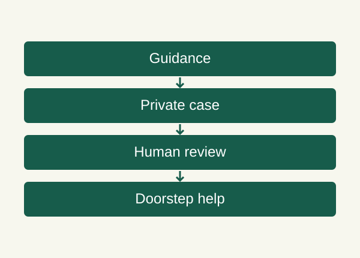

**Speaker notes / what to say:** Introduce this as an independent engineering portfolio project. Synthetic data demonstrates the workflow without claiming citizen adoption or government affiliation.

**Likely interviewer question:** What is actually public?

**Evidence:** [source architecture](ARCHITECTURE.md), [agents](AGENTS.md), [release report](FINAL_RELEASE_REPORT.md).

---

## Slide 2: The project in one minute

- YojanaSetu connects information to case progress
- SevaSetu coordinates the in-person support path
- People retain sensitive decisions

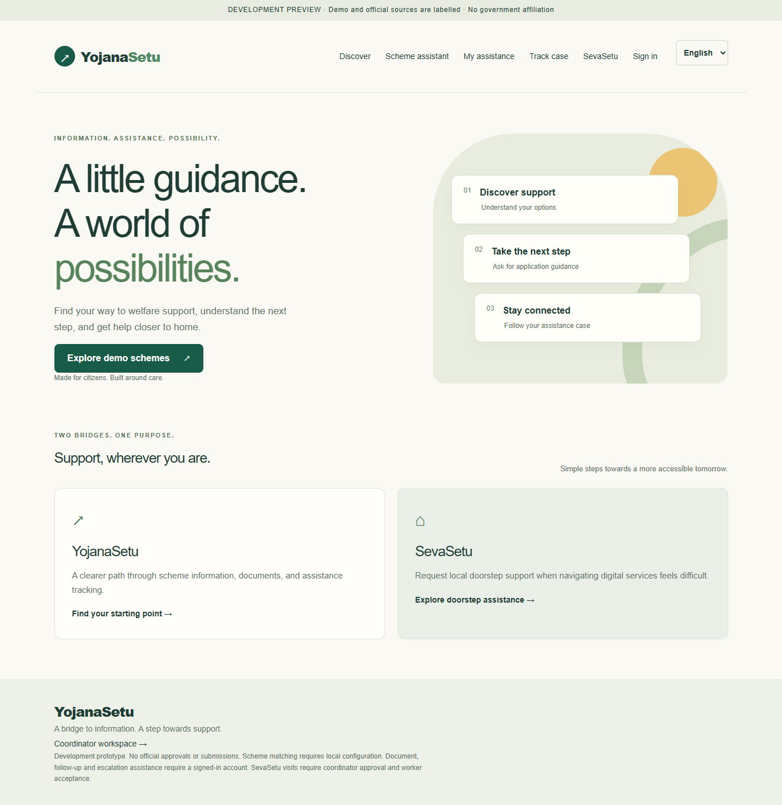

**Speaker notes / what to say:** Explain the distinction between an answer and accountable assistance. The public URL is a static evidence showcase; the complete platform is local.

**Likely interviewer question:** How is this different from a chatbot?

**Evidence:** [source architecture](ARCHITECTURE.md), [agents](AGENTS.md), [release report](FINAL_RELEASE_REPORT.md).

---

## Slide 3: The motivating problem

- Information can be fragmented or incomplete
- Documents and follow-ups need continuity
- A chat answer cannot reserve a worker

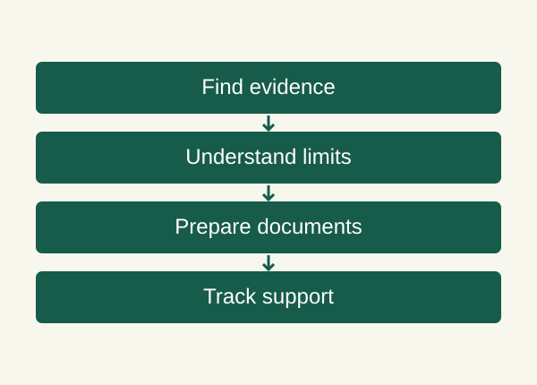

**Speaker notes / what to say:** Discuss intended rural, elderly and digitally less confident users. Do not invent impact statistics or assert field validation.

**Likely interviewer question:** How would you measure impact?

**Evidence:** [source architecture](ARCHITECTURE.md), [agents](AGENTS.md), [release report](FINAL_RELEASE_REPORT.md).

---

## Slide 4: People and authority

- Citizen owns the request
- Worker acts on an eligible assignment
- Coordinator reviews
- Administrator governs accounts and verification

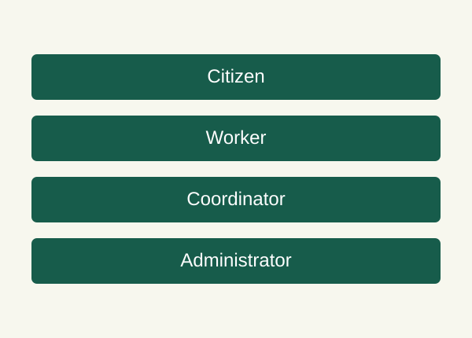

**Speaker notes / what to say:** Different roles do not mean unrestricted access to every object. Case assignment and visit assignment are separate relationships.

**Likely interviewer question:** Why are role checks insufficient alone?

**Evidence:** [source architecture](ARCHITECTURE.md), [agents](AGENTS.md), [release report](FINAL_RELEASE_REPORT.md).

---

## Slide 5: The proposed solution

- Connect discovery to private cases
- Preserve source citations and uncertainty
- Record human decisions and durable progress

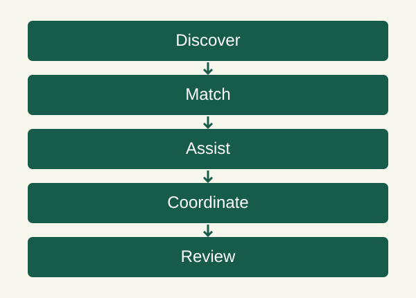

**Speaker notes / what to say:** Walk through a synthetic question becoming a source-backed checklist and then a consented request. Internal assistance never means official approval.

**Likely interviewer question:** What remains outside the system?

**Evidence:** [source architecture](ARCHITECTURE.md), [agents](AGENTS.md), [release report](FINAL_RELEASE_REPORT.md).

---

## Slide 6: Citizen experience

- Individual registration and login
- Cases, uploads and human referrals
- Durable updates and reviewed feedback

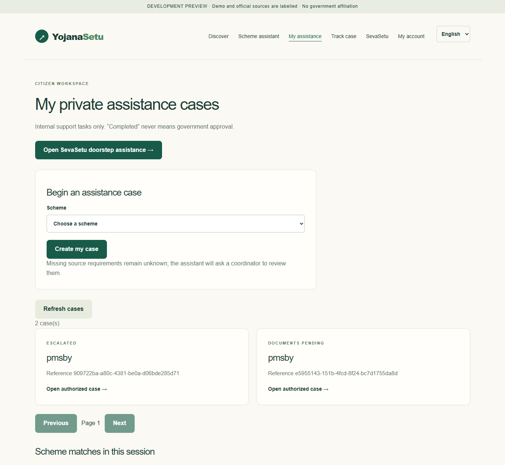

**Speaker notes / what to say:** Point to the actual case dashboard. The screenshots contain synthetic aliases and records, not real citizens or credentials.

**Likely interviewer question:** What survives a browser reload?

**Evidence:** [source architecture](ARCHITECTURE.md), [agents](AGENTS.md), [release report](FINAL_RELEASE_REPORT.md).

---

## Slide 7: Five phases of development

- Foundation and catalogue
- Reviewed local RAG
- Secure case agents
- Doorstep coordination
- Integration and verified release boundaries

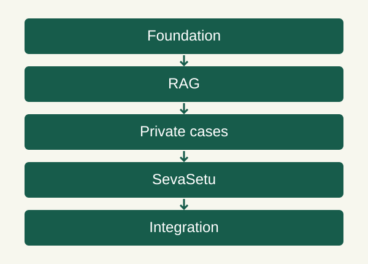

**Speaker notes / what to say:** Explain how later phases reused earlier services instead of rebuilding authentication or databases. Dated phase reports preserve earlier evidence.

**Likely interviewer question:** What changed most after Phase 1?

**Evidence:** [source architecture](ARCHITECTURE.md), [agents](AGENTS.md), [release report](FINAL_RELEASE_REPORT.md).

---

## Slide 8: The implementation stack

- React, TypeScript and Vite
- FastAPI, Pydantic and async PyMongo
- Mongo, private files and Chroma
- LangGraph and local ONNX embeddings

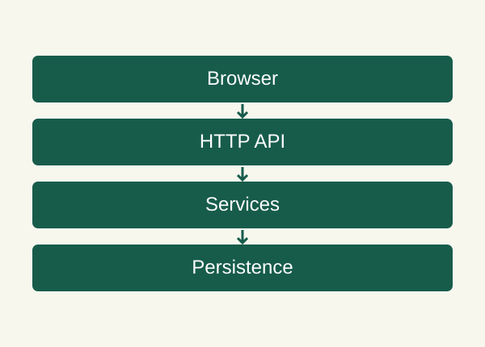

**Speaker notes / what to say:** Say what each layer owns. Tailwind directives coexist with custom CSS. Technology comparisons are retrospective rationale unless documented originally.

**Likely interviewer question:** Why choose these technologies?

**Evidence:** [source architecture](ARCHITECTURE.md), [agents](AGENTS.md), [release report](FINAL_RELEASE_REPORT.md).

---

## Slide 9: System architecture

- Current actor before private work
- Graphs reuse guarded services
- Worker reads durable schedules
- Optional providers remain separate

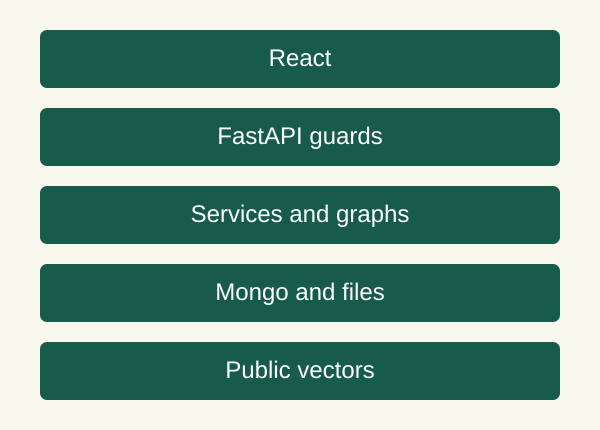

**Speaker notes / what to say:** Trace one button into a service/store and back. Mongo is operational authority, while Chroma searches public evidence. There is no JWT/Redis/Celery service implied.

**Likely interviewer question:** Can an agent bypass security?

**Evidence:** [source architecture](ARCHITECTURE.md), [agents](AGENTS.md), [release report](FINAL_RELEASE_REPORT.md).

---

## Slide 10: Source-grounded retrieval

- Operator reviews PDF or HTML
- Extract, chunk, hash and embed
- Retrieve active evidence
- Evaluate curated rules and validate citations

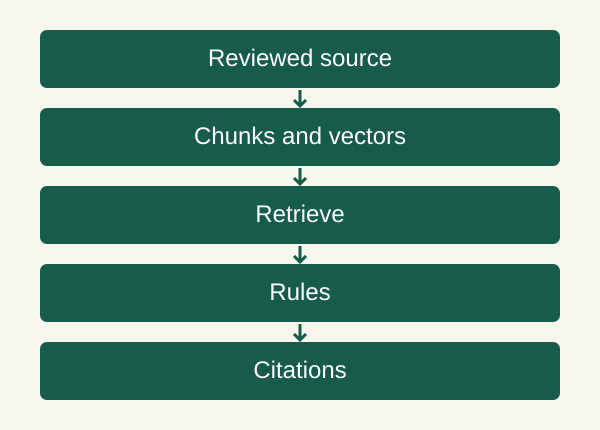

**Speaker notes / what to say:** Use the open-book analogy. Matching a relevant passage cannot certify eligibility when sources are partial or need reconciliation.

**Likely interviewer question:** RAG versus fine-tuning?

**Evidence:** [source architecture](ARCHITECTURE.md), [agents](AGENTS.md), [release report](FINAL_RELEASE_REPORT.md).

---

## Slide 11: Five controlled capabilities

- Scheme Matcher and Doorstep graphs
- Deterministic Document, Follow-up and Escalation
- Authorized shared domain context

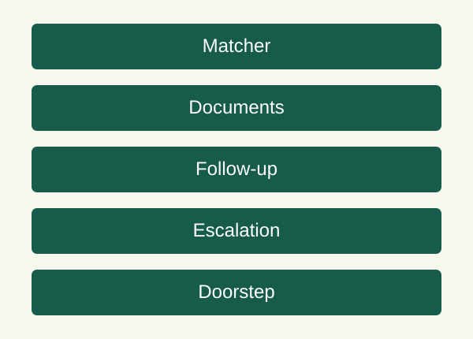

**Speaker notes / what to say:** Avoid claiming five autonomous LLMs. Explain nodes, edges, state and finite routing. No durable LangGraph checkpointer is configured.

**Likely interviewer question:** Is this actually agentic AI?

**Evidence:** [source architecture](ARCHITECTURE.md), [agents](AGENTS.md), [release report](FINAL_RELEASE_REPORT.md).

---

## Slide 12: Case and document assistance

- Source-backed checklist
- Private technical upload checks
- Human checklist review
- Reminders and internal referrals

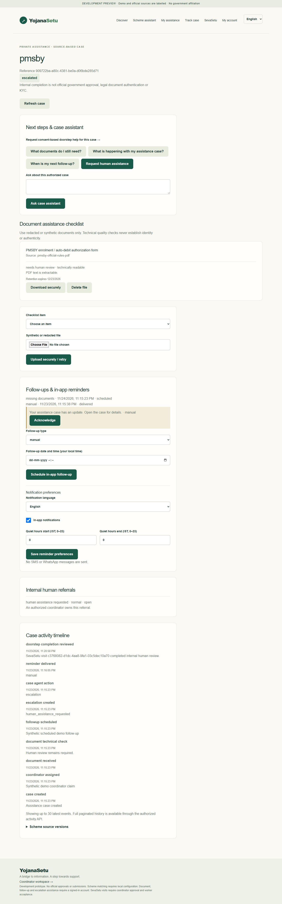

**Speaker notes / what to say:** The actual screen shows a private assistance task. Readability is not authenticity, malware certification, legal validity or KYC. Optional OCR is environment-dependent.

**Likely interviewer question:** Who accepts a document?

**Evidence:** [source architecture](ARCHITECTURE.md), [agents](AGENTS.md), [release report](FINAL_RELEASE_REPORT.md).

---

## Slide 13: SevaSetu lifecycle

- Consent and coordinator review
- Eligible confirmed assignment
- Worker acceptance and check-in
- Outcome, human completion review and feedback

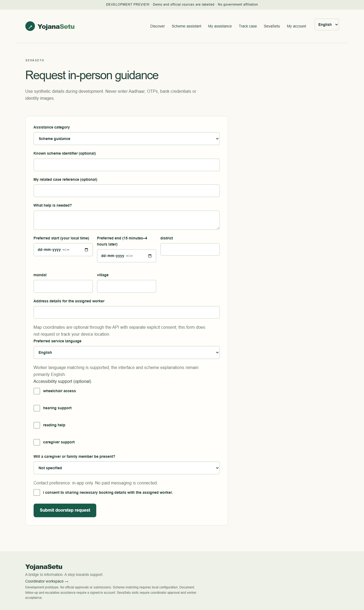

**Speaker notes / what to say:** A structured booking is not a promise of service. Human approval and worker acceptance are distinct. No-show/reschedule/dispute actions are stage-guarded.

**Likely interviewer question:** How is double booking prevented?

**Evidence:** [source architecture](ARCHITECTURE.md), [agents](AGENTS.md), [release report](FINAL_RELEASE_REPORT.md).

---

## Slide 14: Two stores and private files

- Mongo: exact records, permissions and jobs
- Chroma: public reviewed chunks and vectors
- Private filesystem: uploaded document bytes

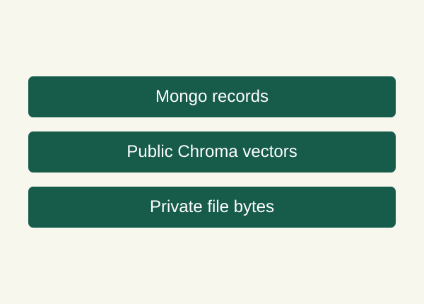

**Speaker notes / what to say:** Show why one vector database cannot authorize cases. Embedded arrays are not separate collections. Backups need a consistent stopped-writer set.

**Likely interviewer question:** Why not one database?

**Evidence:** [source architecture](ARCHITECTURE.md), [agents](AGENTS.md), [release report](FINAL_RELEASE_REPORT.md).

---

## Slide 15: Language and voice boundaries

- English and draft Hindi/Telugu UI
- Device and account language preference
- Consented browser speech and text fallback
- Native speech quality remains unverified

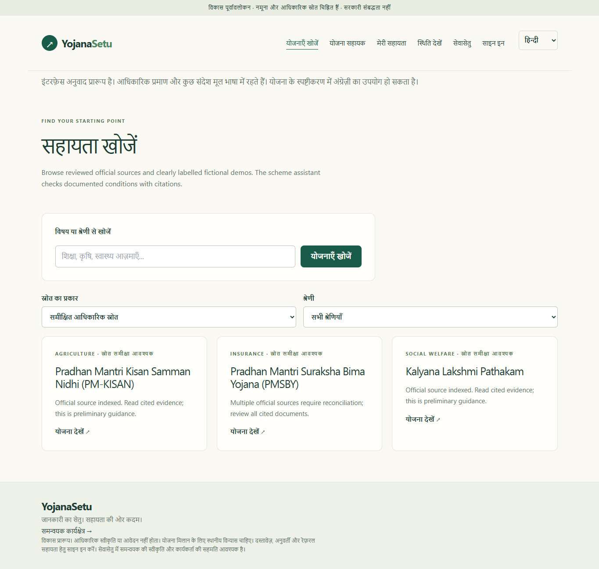

**Speaker notes / what to say:** Show the actual Hindi interface. Measured dictionary coverage does not certify linguistic correctness or multilingual retrieval. No physical microphone claim is made.

**Likely interviewer question:** Does Telugu UI imply Telugu RAG quality?

**Evidence:** [source architecture](ARCHITECTURE.md), [agents](AGENTS.md), [release report](FINAL_RELEASE_REPORT.md).

---

## Slide 16: Security and human control

- Salted scrypt and opaque sessions
- Role plus object authorization
- Private files and explicit consent
- Revisions, receipts and audit

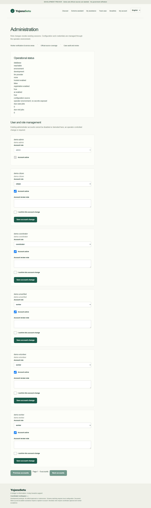

**Speaker notes / what to say:** The admin screen is real synthetic evidence. Public signup cannot set role; existing admin demotion is restricted. Agents call the same guarded services.

**Likely interviewer question:** JWT or server-side sessions?

**Evidence:** [source architecture](ARCHITECTURE.md), [agents](AGENTS.md), [release report](FINAL_RELEASE_REPORT.md).

---

## Slide 17: Verification evidence

- 108 backend tests recorded locally
- 25 frontend tests and five browser suites
- Linux container runtime and persistence passed
- The security gate still fails for Chroma

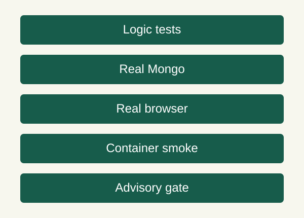

**Speaker notes / what to say:** Name dates and distinguish tests from coverage or accuracy. Mocks validate provider/voice contracts, not live inference, delivery or physical speech.

**Likely interviewer question:** Why can passing tests coexist with red CI?

**Evidence:** [source architecture](ARCHITECTURE.md), [agents](AGENTS.md), [release report](FINAL_RELEASE_REPORT.md).

---

## Slide 18: Deployment truth

- Complete platform is local
- Public Pages hosts static evidence
- No paid plan, card or provider was added
- Persistent backend hosting remains gated

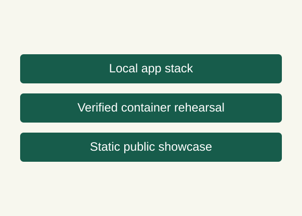

**Speaker notes / what to say:** A visitor's localhost is not the developer PC. Reviewed zero-cost tiers do not meet this native persistent stack plus worker. Container rehearsal is not public production certification.

**Likely interviewer question:** What does the public URL actually serve?

**Evidence:** [source architecture](ARCHITECTURE.md), [agents](AGENTS.md), [release report](FINAL_RELEASE_REPORT.md).

---

## Slide 19: The demonstration result

- A future visit stays available for inspection
- A separate visit has a reviewed simulated outcome
- Citizen feedback persists
- Case sync is retry-safe

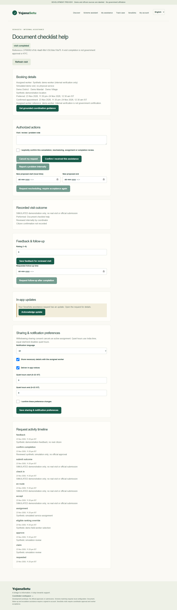

**Speaker notes / what to say:** Use the real completion screen. State explicitly that no physical service or government submission occurred. This is application-level synthetic verification.

**Likely interviewer question:** What happens after a restart?

**Evidence:** [source architecture](ARCHITECTURE.md), [agents](AGENTS.md), [release report](FINAL_RELEASE_REPORT.md).

---

## Slide 20: A genuine engineering challenge

- Restart smoke caught proxy HTTP 502
- Docker service DNS refresh was added
- Readiness and replacement persistence were retested

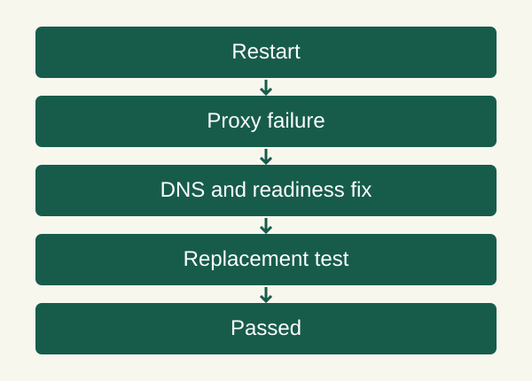

**Speaker notes / what to say:** Explain the observed failure and bounded recovery check. Do not invent latency improvements. The final container job passed while the dependency gate stayed red.

**Likely interviewer question:** Why did the first runtime check matter?

**Evidence:** [source architecture](ARCHITECTURE.md), [agents](AGENTS.md), [release report](FINAL_RELEASE_REPORT.md).

---

## Slide 21: Limits and future evaluation

- Only three schemes and four partial sources
- Unpatched Chroma release gate
- Live models, native speech and external delivery unverified
- Recovery, scale and language evaluation remain

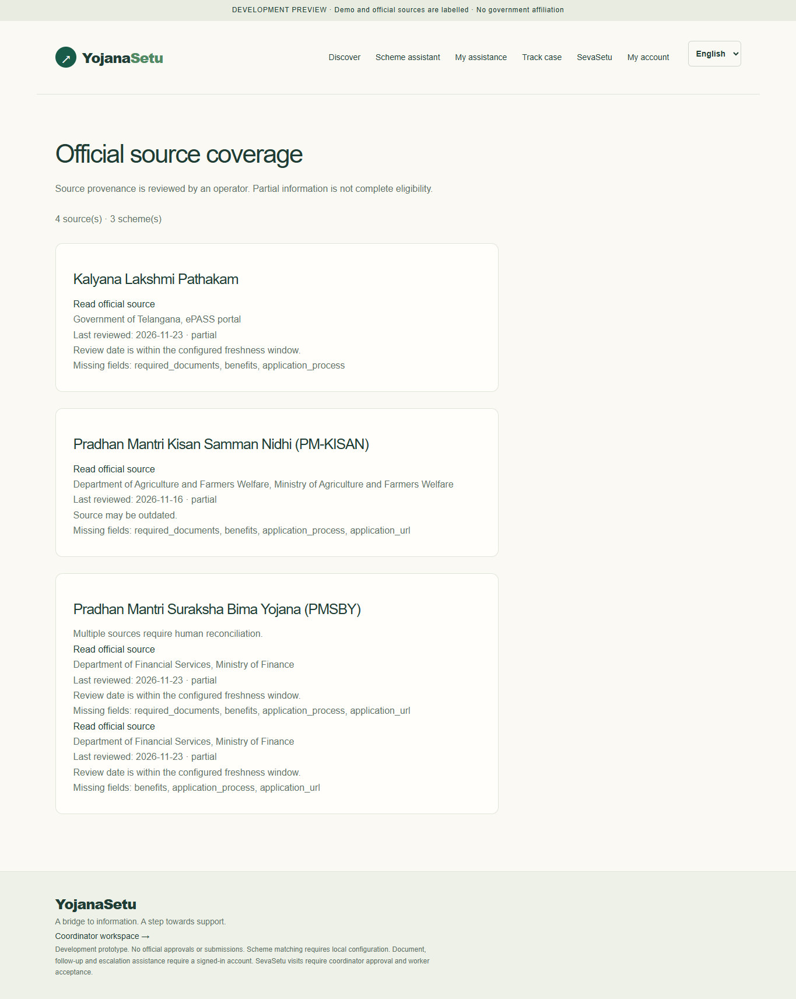

**Speaker notes / what to say:** Point to source coverage. Future proposals include reviewed remediation, stronger recovery/MFA and evaluated multilingual retrieval, without claiming current million-user capacity.

**Likely interviewer question:** What would you improve first?

**Evidence:** [source architecture](ARCHITECTURE.md), [agents](AGENTS.md), [release report](FINAL_RELEASE_REPORT.md).

---

## Slide 22: What this project demonstrates

- Evidence and uncertainty can stay visible
- AI workflows can share guarded domain context
- Human assistance needs durable integrity
- Explain the code and AI-assisted process honestly

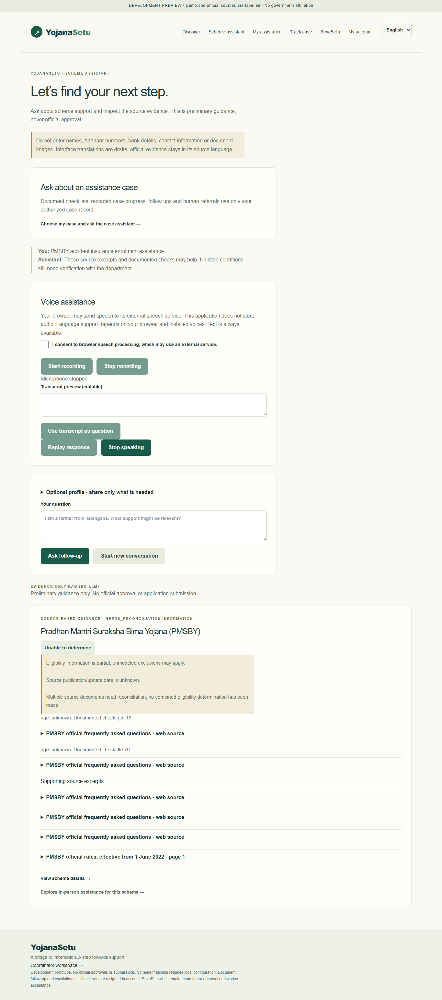

**Speaker notes / what to say:** Close with the source repository and real public showcase. Invite a source-level question and explain what you personally reviewed rather than claiming manual authorship of every line.

**Likely interviewer question:** Which component can you defend independently?

**Evidence:** [source architecture](ARCHITECTURE.md), [agents](AGENTS.md), [release report](FINAL_RELEASE_REPORT.md).

---

## Export files

[Verified 22-page PDF](../presentations/YojanaSetu-SevaSetu.pdf) and [editable HTML with speaker-note toggle](../presentations/YojanaSetu-SevaSetu.html). The PDF is for presenting; edit the Markdown/HTML to revise content. A PowerPoint file was not generated: this session exposes no presentation artifact/export runtime, so no unverified PPTX is claimed.
