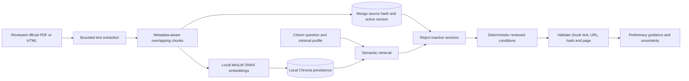

# RAG and source provenance

Only an operator can ingest sources. The CLI checks HTTPS government domains, public
DNS resolution, redirects, MIME, size/page limits, PDF extraction and manually reviewed
metadata. Required document/rule fields need supporting source quotations. Numeric rule
thresholds must occur in the supporting quotation. Synthetic fixtures require isolated
test collections and never become verified catalogue entries.



Current local coverage: **three schemes, four partial official documents**: PM-KISAN
portal, Department of Financial Services PMSBY FAQ, Telangana ePASS Kalyana Lakshmi
services, and the official PMSBY rules PDF. The PDF has three pages/eight chunks and
documents a limited enrolment/auto-debit form checklist item. It is not a complete bank
onboarding checklist. The PDF says effective 1 June 2022; publication date is unknown.
Multiple PMSBY documents require reconciliation, so no combined positive eligibility
decision is inferred. Telangana category/residence-specific thresholds are not generalized.

See [SOURCE_COVERAGE.json](SOURCE_COVERAGE.json) for actual department, official URL,
verification, completeness, missing fields, freshness and content/version hashes.
`/api/ai/coverage` and `/sources` provide live reporting. Metadata history is retained
going forward; raw downloads and local database/vector contents are ignored by Git.

From `backend`, review the current source first, then run:

```powershell
.\.venv\Scripts\python.exe -m app.ai.cli --manifest sources/pmsby-rules-pdf.json --confirm-reviewed
.\.venv\Scripts\python.exe -m scripts.verify_phase4_sources
```

The ingestion CLI downloads the manifest's official URL unless `--file` is supplied.
The non-www `jansuraksha.gov.in` URL passed TLS verification; the www variant failed
certificate validation here. TLS verification was never disabled. Ingest with API/vector
writers stopped; unchanged versions are detected and old active chunks are replaced.
Case source versions preserve review context and can be explicitly refreshed.

Verified operating mode is retrieval-only. Optional Ollama/hosted adapters can rewrite
retrieval queries or select existing excerpts/facts; they cannot invent claims or tools.
Provider-reported token counts are exposed in `model_usage` only when supplied; cost is
unknown rather than fabricated. Limits are configurable; hosted calls default off.
No live local model server was reachable. Hindi/Telugu free-text retrieval quality has
not been established with the English embedding model; static interface translation
does not imply multilingual legal interpretation or verified multilingual generation.
