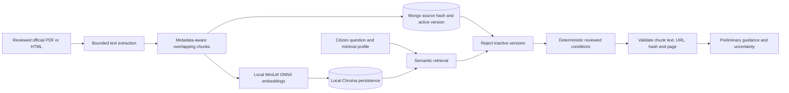

# RAG and source provenance

Only an operator can ingest sources. The CLI checks HTTPS government domains, public
DNS resolution, redirects, MIME, size/page limits, PDF extraction and manually reviewed
metadata. Required document/rule fields need supporting source quotations. Numeric rule
thresholds must occur in the supporting quotation. Synthetic fixtures require isolated
test collections and never become verified catalogue entries.



Current local coverage: **three schemes, four partial official documents**: PM-KISAN
portal, Department of Financial Services PMSBY FAQ, Telangana ePASS Kalyana Lakshmi
services, and the official PMSBY rules PDF. The PDF has three pages/eight chunks and
documents a limited enrolment/auto-debit form checklist item. It is not a complete bank
onboarding checklist. The PDF says effective 1 June 2022; publication date is unknown.
Multiple PMSBY documents require reconciliation, so no combined positive eligibility
decision is inferred. Telangana category/residence-specific thresholds are not generalized.

See [SOURCE_COVERAGE.json](SOURCE_COVERAGE.json) for actual department, official URL,
verification, completeness, missing fields, freshness and content/version hashes.
`/api/ai/coverage` and `/sources` provide live reporting. Metadata history is retained
going forward; raw downloads and local database/vector contents are ignored by Git.

From `backend`, review the current source first, then run:

```powershell
.\.venv\Scripts\python.exe -m app.ai.cli --manifest sources/pmsby-rules-pdf.json --confirm-reviewed
.\.venv\Scripts\python.exe -m scripts.verify_phase4_sources
```

The ingestion CLI downloads the manifest's official URL unless `--file` is supplied.
The non-www `jansuraksha.gov.in` URL passed TLS verification; the www variant failed
certificate validation here. TLS verification was never disabled. Ingest with API/vector
writers stopped; unchanged versions are detected and old active chunks are replaced.
Case source versions preserve review context and can be explicitly refreshed.

Verified operating mode is retrieval-only. Optional Ollama/hosted adapters can rewrite
retrieval queries or select existing excerpts/facts; they cannot invent claims or tools.
Provider-reported token counts are exposed in `model_usage` only when supplied; cost is
unknown rather than fabricated. Limits are configurable; hosted calls default off.
No live local model server was reachable. Hindi/Telugu free-text retrieval quality has
not been established with the English embedding model; static interface translation
does not imply multilingual legal interpretation or verified multilingual generation.


## Beginner model: an open-book examination

An embedding is a numerical description of text. A vector database finds nearby descriptions, like a library
index grouping related topics. RAG then opens the relevant passages before answering. This improves access to
reviewable evidence; it does not certify the evidence is complete, current or legally sufficient.

The actual chunk defaults are 1100 characters with 200 overlap, not 1100 tokens. Source metadata preserves URL,
page, hash, reviewed/publication dates and active index version. Query text is embedded by the same model.
Cosine distance/top-k bound candidates; active metadata and exact citations provide additional checks.
Changing embedding identity needs a new collection and re-ingestion. Sources are reviewed through an operator
CLI, not fetched from arbitrary URLs in a citizen's message.

## Worked example: PMSBY assistance

1. **Actual reviewed source:** `backend/sources/pmsby-rules-pdf.json` names the official non-www
   `https://jansuraksha.gov.in/Files/PMSBY/English/Rules.pdf`. Its title identifies an effective date;
   the publication date is unknown, so the manifest stores null rather than inventing a date.
2. **Ingestion:** valid TLS/official provenance and supporting field evidence are required. Three pages
   produced eight chunks in the recorded index; page/hash/version are retained.
3. **Synthetic question:** "PMSBY accident insurance enrolment assistance", optionally with a minimal
   age/state profile. This is a teaching input, not real citizen information.
4. **Retrieval:** local ONNX vectors can retrieve relevant reviewed evidence. The source-backed item
   includes the phrase "Enrolment form / Auto-debit authorization" on page3.
5. **Rules/result:** the PDF itself has no curated eligibility rules. The scheme also has a separate FAQ
   source. Multi-source reconciliation and partial coverage mean a relevant passage is not a complete
   eligibility determination. Unknown status/warnings are correct behavior.
6. **Citation/checklist:** a result can expose the actual document title, official URL, page, chunk/source
   identity and quotation/hash. The case checklist includes only the supported PMSBY enrolment/auto-debit
   form item from this source; the application does not invent Aadhaar requirements or mandatory uploads.
7. **Follow-up:** a question about missing information uses session-owned minimal profile and prior
   scheme IDs. A source-backed answer remains separate from a government approval or successful submission.

This example is supported by real source/browser integration evidence, but the explanation above is not
presented as an exact captured JSON response. [Source coverage](SOURCE_COVERAGE.json) records the catalogue.

## What reduces hallucination, and what remains

Source allowlists/review, typed rules with verbatim supporting evidence, active hash/version filtering,
source-age warnings and citation checks reduce unsupported output. Optional models may rewrite a query or
select permitted excerpts/facts; they cannot invent new tools or legal conditions. No relevant evidence
produces an explicit cannot-verify response, not a claim that no scheme exists. RAG is different from
fine-tuning: this project indexes reviewed text without training foundation-model weights.

Retrieval quality and source completeness are separate. There is no invented accuracy percentage,
comprehensive multilingual benchmark or live generation claim. Hindi/Telugu static UI coverage does not
certify those languages' free-text semantic retrieval with the English embedding/parser configuration.
