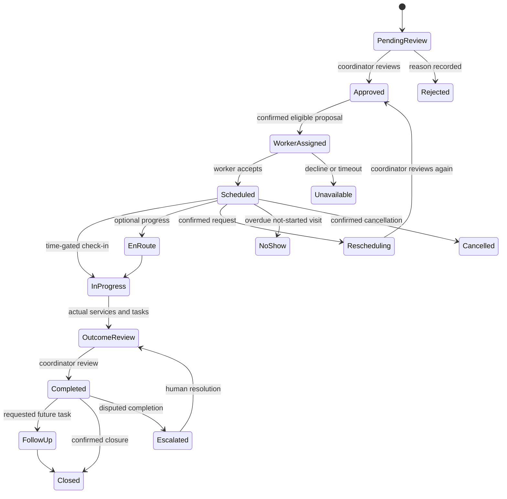
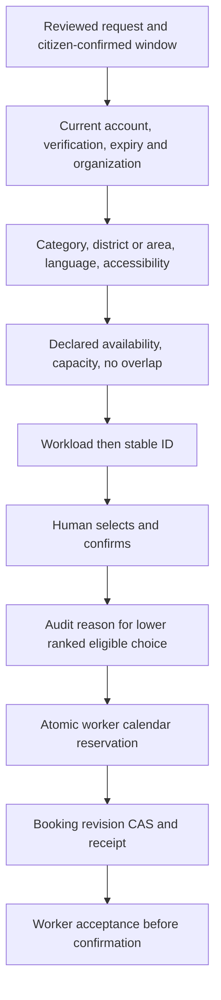

# SevaSetu workflow and authority

Citizens request a category, optional scheme/case, preferred time, location, language,
accessibility/caregiver needs and necessary sharing consent. Contact is in-app only.
Coordinates are optional API fields with separate explicit consent. No identity image,
Aadhaar, OTP, bank login, visit photo or covert location history is required.

Overrides cannot bypass eligibility or conflicts. Workers receive only assigned
requests; precise location is withheld before acceptance and outside active stages.
Terminal worker access is denied. A language change or consent withdrawal can revoke
an active assignment. Rescheduling never bypasses initial review. Recorded outcomes
cannot be erased by cancellation/rescheduling after a dispute; human review is required.

MongoDB's atomic worker document is the reservation authority. Standalone Mongo does
not make worker/calendar and booking updates one transaction. A crash may temporarily
hold capacity; reconciliation releases only when booking revision/state proves an
in-flight update cannot still commit. UTC seconds are stored; Asia/Kolkata is displayed.
The polling worker handles acceptance timeout, missed visits, notices and retention.

Administrators review workers, expiry and external-authorization evidence. Internal
verification is not government certification. Material profile changes reset it;
future reserved visits must be resolved before eligibility edits. Staff queues expose
actual records and workload, not fake metrics. Visit completion adds one generic case
activity/notice through an idempotent outbox; official case approval never changes.

Exact endpoints and role boundaries are in [API_REFERENCE.md](API_REFERENCE.md).
The Phase 4 Chrome workflow and Mongo concurrency tests demonstrate the full role path.

## Beginner explanation and exact state boundary

Think of a support appointment desk: a request, an available person and a performed-service record are
different things. fresh_booking starts at pending_coordinator_review, not an automatically confirmed
appointment. The diagram summarizes representative transitions, not a promise that every actor can move
between arbitrary stages. VisitStage in seva/models.py and action guards in SevaService are authoritative.

| Concept | Relevant implementation |
| --- | --- |
| Verification | Current active worker account and internal verification expiry through appointment end |
| Coverage | Category/language, district plus optional mandal/village areas, accessibility capability and active organization |
| Ranking | Current workload, then worker_id, with a recorded reason for lower-ranked selection |
| Reservation | One atomic worker document checks revision, overlap, verification and capacity |
| Acceptance | Assignment proposal is separate from worker acceptance and visit_scheduled |
| Check-in/outcome | Accepted worker, legal stage, time window, performed categories/tasks and review note |
| Completion | Coordinator explicitly reviews a submitted outcome; citizen confirmation/feedback are separate |
| Cancellation/reschedule | Confirmed authorized actions before performed outcomes; new acceptance required after reschedule |
| Missed visit | Overdue not-started appointment, release/escalation/notice rules |
| Follow-up | Future internal task after reviewed completion, not a government follow-up integration |

## Complete synthetic example

A citizen requests document_assistance in Demo District, language en, and a future one-hour window.
They consent to sharing necessary booking details and link their owned PMSBY case. A coordinator claims
and approves the request. Candidates must fit category, language, area, capabilities, verification and
availability; an unverified profile is excluded even when its calendar is free.

The coordinator chooses an eligible worker and explicitly confirms the proposal. The service rechecks
current data and atomically reserves the calendar; two stale overlapping proposals cannot both win.
The worker accepts, then checks in within the permitted time window, records simulated services/tasks
and submits the outcome. A coordinator reviews it, and the citizen can submit feedback. The completion
outbox appends linked case activity exactly through its stable receipt, without approving any benefit.

This is a teaching example matching the synthetic demonstration. It does not assert that a real visit
occurred. If no worker fits, show unavailability/human review/rescheduling instead of relaxing eligibility.
No nearest-distance routing, government worker certification or continuous GPS tracking is implemented.

[Exact UI rehearsal](DEMO_SCRIPT.md) and [calendar interview questions](INTERVIEW_GUIDE.md).
