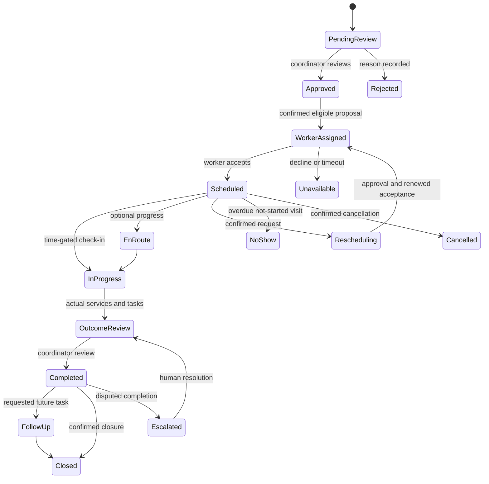
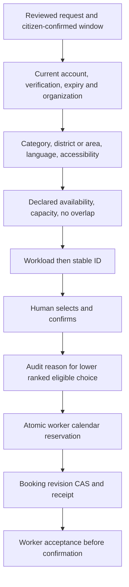

# SevaSetu workflow and authority

Citizens request a category, optional scheme/case, preferred time, location, language,
accessibility/caregiver needs and necessary sharing consent. Contact is in-app only.
Coordinates are optional API fields with separate explicit consent. No identity image,
Aadhaar, OTP, bank login, visit photo or covert location history is required.

Overrides cannot bypass eligibility or conflicts. Workers receive only assigned
requests; precise location is withheld before acceptance and outside active stages.
Terminal worker access is denied. A language change or consent withdrawal can revoke
an active assignment. Rescheduling never bypasses initial review. Recorded outcomes
cannot be erased by cancellation/rescheduling after a dispute; human review is required.

MongoDB's atomic worker document is the reservation authority. Standalone Mongo does
not make worker/calendar and booking updates one transaction. A crash may temporarily
hold capacity; reconciliation releases only when booking revision/state proves an
in-flight update cannot still commit. UTC seconds are stored; Asia/Kolkata is displayed.
The polling worker handles acceptance timeout, missed visits, notices and retention.

Administrators review workers, expiry and external-authorization evidence. Internal
verification is not government certification. Material profile changes reset it;
future reserved visits must be resolved before eligibility edits. Staff queues expose
actual records and workload, not fake metrics. Visit completion adds one generic case
activity/notice through an idempotent outbox; official case approval never changes.

Exact endpoints and role boundaries are in [API_REFERENCE.md](API_REFERENCE.md).
The Phase 4 Chrome workflow and Mongo concurrency tests demonstrate the full role path.
