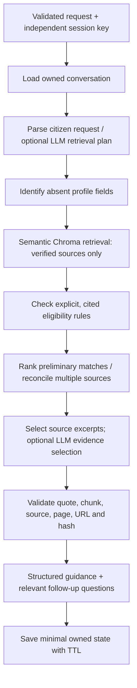

# Phase 2: source-grounded Scheme Matcher

Implemented 16 November 2026 as an extension to Phase 1. No Phase 3 work, deployment,
government submission or paid model call was performed.

## Architecture and graph

React's `/assistant` calls protected FastAPI matching/chat endpoints. The service
merges a minimal conversation profile from MongoDB with explicit updates, invokes
the LangGraph workflow, and persists only the new profile and matched scheme IDs.
Chroma stores document chunks and embeddings; Mongo stores source metadata, active
versions, public scheme summaries and expiring conversation state. Existing cases,
doorstep requests and Phase 1 routes remain compatible.



The eight graph nodes are real LangGraph nodes. Eligibility never comes from a
model's free-text decision. The LLM may rewrite a retrieval query and select supplied
evidence IDs; any other model output is ignored. Returned scheme claims are exact
source excerpts or deterministic comparisons against manually reviewed rules.
This conservative design deliberately avoids generated paraphrases that only appear
grounded because they have a citation. The application cannot prove that every
source statement is correct or current; reviewer provenance and freshness matter.

The narrow English parser recognizes explicit phrases such as “I am a farmer from
Telangana” and “I am 55 years old”. Other details use the optional typed form.
Form changes override parsed values; later conversational corrections override saved
values. Unknown information remains null. Clearing a form field removes that value.
The missing-profile node records absent fields; questions are asked only when a
retrieved, current condition needs that field. Stale or unsupported rules do not
trigger unnecessary profile collection.

## Source ingestion

`python -m app.ai.cli` is a local administrative CLI, never a public API endpoint.
It requires `--confirm-reviewed`. A `.gov.in`/`.nic.in` URL alone does not verify
scheme conditions: the operator must review the responsible department, date,
document authenticity, exclusions, units and exact quotations before confirmation.

Pipeline:

1. Validate a `SourceManifest`: scheme identity, department, scope, URL, document
   title, known publication/update date, review date, verification and completeness.
2. Download a public HTTPS government PDF/HTML, or read an operator-provided file.
   Each redirect is revalidated; IP/private-network destinations and other domains
   are rejected. Windows/system certificate validation remains enabled.
3. Enforce file signatures/types, 15 MB and 150-page defaults. Extract PDF text with
   PyMuPDF, keeping 1-based page numbers. HTML keeps web-form content while removing
   scripts, styles, navigation and input controls. Scans without text require external,
   reviewed OCR; this application does not silently invent extracted text.
4. Clean whitespace and create per-page 1,100-character chunks with 200-character
   overlap. Every chunk retains document title, page, source URL, scheme/source ID,
   content SHA-256 and index version. HTML has no invented page number.
5. Validate curated rule quotations against chunks; numeric thresholds must occur
   in the supporting quote. Optional curated scheme facts require `field_evidence`.
   The operator still verifies semantics, units and boolean/exclusion interpretation.
6. Generate embeddings and upsert Chroma chunks. Index identity includes content,
   manifest metadata/rules, embedding model and chunking version. Identical ingestion
   skips embedding; changed bytes or metadata cause reindexing.
7. Activate the new version in Mongo and publish its scheme summary. Only active
   source versions can be retrieved. Old vector versions are then removed. Retry
   repairs scheme publication after an interrupted activation. No distributed
   Mongo/Chroma transaction is claimed; run one ingestion writer at a time.

Demo schemes never enter the verified collection. Synthetic fixtures require a
`synthetic_` collection and an explicit internal test-only argument. The CLI refuses
synthetic manifests, and documents marked `SYNTHETIC TEST DOCUMENT` cannot be
promoted to verified sources. Synthetic tests do not publish catalogue schemes.

To add another source, copy and edit `backend/sources/pm-kisan-portal.json`. Unknown
fields should be null/omitted, not guessed. Rules specify `field`, `operator`, typed
`value`, `source_id` and a verbatim `quote`. Supported operators are eq/gte/lte/in.
All numeric profile/threshold amounts are annual rupees unless a curated field
explicitly documents otherwise; do not convert lakh/monthly units implicitly.
Keep completeness partial unless every relevant condition/exclusion is reviewed.
Rule and metadata quotations must fit a chunk; shorter exact excerpts are preferable.

Example optional field: `"benefits": ["reviewed description"]` requires
`"field_evidence": {"benefits": "exact supporting quote"}`. These facts are human
curation, not model extraction. An application URL also needs a supporting quote
and an allowed official HTTPS domain. Other official domains need a reviewed code
policy extension; ordinary users cannot expand the allowlist.

## Actual official source loaded

- Scheme: Pradhan Mantri Kisan Samman Nidhi (PM-KISAN).
- Source: [official PM-KISAN portal](https://pmkisan.gov.in/), scheme/exclusion text.
- Department: Agriculture and Farmers Welfare, Ministry of Agriculture and Farmers Welfare.
- Scope: central; coverage: India.
- Page footer displayed last updated **20 June 2025**; reviewed/retrieved **16 November 2026**.
- Snapshot SHA-256: `34a0297a840aea76074eeb03179e1dc49249cad648a2317fdfdd957b3b744e14`.
- Six Chroma chunks; a repeat ingestion returned `unchanged`.
- One manually reviewed institutional-landholder exclusion; all remaining conditions
  and required documents are intentionally incomplete. No invented list is supplied.
- This source is partial and its displayed update date exceeds the default 365-day
  threshold. The matcher returns **Unable to determine**, with an outdated-source
  warning, even when its one modeled condition is met. A positive eligibility
  conclusion was not claimed. The old FAQ PDF was not ingested as current guidance.

The raw downloaded snapshot and database/model files are ignored local artifacts,
not committed source data. The manifest and hash document this reviewed snapshot.
Re-downloading may produce a different hash; inspect changes before confirming a
new ingestion. This is a one-source development catalogue, not national coverage.

## Windows setup and run commands

Prerequisites: Python 3.12, Node 22.12+ LTS, MongoDB running on loopback. From the
repository root, in PowerShell:

```powershell
cd backend
py -3 -m venv .venv
.\.venv\Scripts\python.exe -m pip install -r requirements.lock.txt
if (!(Test-Path .env)) { Copy-Item .env.example .env }
.\.venv\Scripts\python.exe -c "import secrets; print(secrets.token_urlsafe(32))"
```

Set these values in `backend/.env`; paste your generated token instead of the example:

```dotenv
APP_ENV=development
ENABLE_AI=true
ENABLE_DEV_CASE_ACCESS=true
DEV_ACCESS_TOKEN=your-generated-random-token-at-least-32-characters
MONGODB_URI=mongodb://127.0.0.1:27017
MONGODB_DATABASE=yojanasetu
CHROMA_PATH=./data/chroma
CHROMA_COLLECTION=verified_schemes_v1
EMBEDDING_PROVIDER=onnx
EMBEDDING_MODEL=all-MiniLM-L6-v2
LLM_PROVIDER=none
```

Review the manifest/source, then from `backend/` ingest and run:

```powershell
.\.venv\Scripts\python.exe -m app.ai.cli --manifest sources/pm-kisan-portal.json --confirm-reviewed
# Alternatively, after reviewing a local official PDF and editing its manifest:
# .\.venv\Scripts\python.exe -m app.ai.cli --manifest sources/my-scheme.json --file C:\Sources\scheme.pdf --kind pdf --confirm-reviewed
.\.venv\Scripts\python.exe -m uvicorn app.main:app --reload --host 127.0.0.1 --port 8000
```

Stop the serving process while administrative ingestion is writing. `--file` needs
no source download but still needs MongoDB and an embedding model. Offline first-run
ONNX use requires pre-caching its model. The download uses system TLS trust; do not
turn off certificate checks to work around a site's certificate problem.

Second terminal, from repository root:

```powershell
cd frontend
if (!(Test-Path .env)) { Copy-Item .env.example .env }
npm ci
npm run dev
```

Open http://localhost:5173/assistant. Enter the token from the backend environment
in the local form. Tokens never belong in Vite variables. Other Phase 1 pages remain
available. `.env` and database/model files are ignored by Git.

On this authoring machine Node/npm are bundled with Codex rather than on PATH.
The already-installed frontend can be restarted from `frontend/` using:

```powershell
$env:PATH = 'C:\Users\dhroo\.cache\codex-runtimes\codex-primary-runtime\dependencies\node\bin;' + $env:PATH
node ..\.tools\package\bin\npm-cli.js run dev
```

This fallback is machine-specific and uses ignored local tooling. Other machines
should install Node and use the standard npm commands above. The local backend
`.env` has Phase 2 enabled with a generated private development token; the committed
`.env.example` keeps it disabled until explicitly configured.

## Models, Chroma and costs

Default ONNX embeddings use `all-MiniLM-L6-v2`, 384 dimensions, through Chroma's
local CPU implementation. The first embed downloads about 80 MB into the user's
Chroma model cache; inference thereafter is local and free of provider charges.
Python dependencies and the cache require disk space beyond that download. Chroma's
embedded PersistentClient creates `backend/data/chroma` automatically; no separate
Chroma server is needed for this single-process development setup.

`LLM_PROVIDER=none` is explicitly labelled evidence-only mode. It runs real semantic
retrieval and LangGraph, but no language model. For local LLM use, install
[Ollama for Windows](https://docs.ollama.com/windows), then:

```powershell
ollama pull qwen2.5:3b
# If the Ollama background server is not already running:
ollama serve
```

Set `LLM_PROVIDER=ollama`, `LLM_MODEL=qwen2.5:3b` and
`MODEL_BASE_URL=http://127.0.0.1:11434` in backend `.env`, then restart FastAPI.
The [3B model](https://ollama.com/library/qwen2.5:3b) is approximately a 1.9 GB download
and uses the Qwen license. Allow several GB of working RAM in addition to model
storage; an 8+ GB development machine is a practical starting point, not a guarantee
of speed. CPU-only generation can be slow. Adjust `MODEL_TIMEOUT_SECONDS` and
`AI_TIMEOUT_SECONDS` for hardware. No Ollama runtime/model was installed here.

For Ollama embeddings instead, set `EMBEDDING_PROVIDER=ollama`, choose an installed
embedding model and a **new** Chroma collection, then re-ingest. The identity check
rejects mixing different embedding models in an existing collection. One base URL
is shared by local embedding/chat adapters; use ONNX when selecting a remote LLM.

`LLM_PROVIDER=openai_compatible` uses `MODEL_BASE_URL` (including its `/v1` prefix
when required), `LLM_MODEL` and `MODEL_API_KEY`. Provider charges may apply and raw
questions/source excerpts leave the machine. It is never selected automatically;
no remote paid provider was connected or tested. Both network adapters have mocked
protocol tests. LLM timeouts/invalid output fall back to explicit evidence-only
explanations; embedding failure returns 503, never fake vectors.

Default retrieval: top 8 chunks, cosine distance <= 0.65. This is a relevance
cutoff, not an eligibility percentage or calibrated confidence score. Tune against
a reviewed evaluation set before broader use. Empty/irrelevant results say that
information cannot currently be verified. Official/synthetic metadata filters keep
test evidence out of normal matching. An optional `scope` request field filters the
index to central/state sources. State/age are evaluated only through explicit
curated rules, never inferred from missing source metadata.

## API examples and privacy

Endpoints:

- `POST /api/ai/scheme-match`: begin a new match or use an owned conversation.
- `POST /api/ai/scheme-chat`: same contract for follow-up questions.
- `GET /api/ai/schemes/{scheme_id}/sources`: public reviewed source metadata only.

Example from PowerShell, with the backend running:

```powershell
$devToken = Read-Host 'Local token from backend .env'
$browserKey = [guid]::NewGuid().ToString('N')
$headers = @{ 'X-Dev-Token' = $devToken; 'X-Session-Key' = $browserKey }
$body = @{ question = 'I am a farmer from Telangana'; profile = @{} } | ConvertTo-Json
$match = Invoke-RestMethod -Method Post -Uri http://localhost:8000/api/ai/scheme-match -Headers $headers -ContentType application/json -Body $body
$followUp = @{ question = 'I am 55 years old'; conversation_id = $match.conversation_id; profile = @{} } | ConvertTo-Json
Invoke-RestMethod -Method Post -Uri http://localhost:8000/api/ai/scheme-chat -Headers $headers -ContentType application/json -Body $followUp
```

Responses include profile values, mode, structured classifications, exact evidence,
condition checks, warnings, relevant follow-up questions and graph trace. They never
include eligibility percentages or an official approval. Unknown profile fields
remain null. Explicit null profile updates clear a saved value.

Until authentication exists, match/chat require development environment, the Phase 1
local token gate, ENABLE_AI and an independent session key. Production blocks these
endpoints regardless of flags. Conversation IDs are random 256-bit capabilities,
never query-string parameters; session ownership uses a hash of the independent key.
Another session gets 404 even with the same shared development token. The UI keeps
keys, active turns and matched results in tab memory, not localStorage. Starting a
new conversation clears the UI; old minimal server records expire via Mongo TTL.

Only optional profile fields and matched scheme IDs persist. No transcript, raw
question, prompt, response, identity image or contact field is saved. Tracing is
explicitly disabled around the graph. Prompts treat documents/questions as untrusted;
models have no tool execution or access to ingestion. Quoted instructions from a
document remain inert source text. PII-pattern rejection is a guardrail, not a
comprehensive privacy detector; use fictional profiles only during development.

Matching is limited to 10 requests/minute per IP, two simultaneous graph runs and
per-conversation serialization within one process. Overload gets 429 with Retry-After;
timeouts get 504; provider/index/database availability errors get safe 503 responses.
For multiple API workers, deploy shared gateway/Redis rate limits and conversation
locking **after** implementing proper authentication/authorization. This phase is
deliberately single-process local development, not public multi-user hosting.

## Tests and verification

Final verification: **42 backend pytest tests passed** (including the real MongoDB
integration test), **7 frontend tests passed** across 3 files, Ruff lint/format and
ESLint passed, `pip check` found no broken requirements, and TypeScript/Vite production
build passed (25 modules). Both original Phase 1 and new Phase 2 Chrome workflows
passed with zero JavaScript page errors. The real-source API smoke check passed
with local ONNX, Chroma and MongoDB. These results do not include a live LLM test.

From `backend/`, with Mongo running:

```powershell
$env:MONGO_TEST_URI='mongodb://127.0.0.1:27017'
.\.venv\Scripts\python.exe -m pytest -q
.\.venv\Scripts\python.exe -m ruff check .
.\.venv\Scripts\python.exe -m ruff format --check .
.\.venv\Scripts\python.exe -m pip check
.\.venv\Scripts\python.exe -m scripts.verify_phase2
# Chrome and Node must be installed. Set CHROME_BINARY / NODE_BINARY if needed.
.\.venv\Scripts\python.exe -m scripts.verify_phase2_browser
# Original Phase 1 browser regression check:
.\.venv\Scripts\python.exe -m scripts.verify_browser
```

Browser dependencies are in `requirements-browser.txt` (also present in the tested
development lock). New browser checks need ports 5175/8002; Phase 1 uses 5174/8001.
API smoke/browser checks use the ingested official knowledge base, create fictional
test profiles and remove their own conversation records afterward. The original
Mongo pytest test uses and deletes a uniquely named database.

Automated Phase 2 tests use generated **synthetic** two-page PDFs, deterministic test
embeddings, real temporary Chroma collections and mocked/disabled LLMs. They cover
PDF extraction, metadata, chunks, duplicate/reindex behavior, synthetic isolation,
threshold evidence, citations, unsupported claims, all eight graph transitions,
missing/partial/stale information, API validation, privacy/session isolation and rate
limits. The synthetic end-to-end test does not claim an actual LLM or official
eligibility determination. Frontend tests cover agent interactions, errors, citation
rendering, reset and follow-up corrections. Run frontend checks from `frontend/`:

```powershell
npm test
npm run lint
npm run build
```

The local real-source API and Chrome smoke checks passed with ONNX, Chroma, MongoDB
and the actual PM-KISAN snapshot. They verified follow-up corrections, independent
session isolation, stale-source warnings, source links, dashboard matches and source
filtering. No live LLM end-to-end test is claimed. Windows application control
required compatible native-wheel versions; these are captured in the lockfile.

## Known limits and future boundaries

- One reviewed, partial, dated government source; no completeness or freshness guarantee.
- Extractive evidence selection, not unrestricted generative answers. Local/remote
  LLM execution remains unverified in this environment.
- No OCR, automatic fact/rule extraction, scheduled refresh, nationwide ingestion,
  calibrated retrieval confidence, authentication or production tenancy.
- Multiple documents for one scheme are conservatively marked as needing reconciliation.
  Catalogue publication reflects the last ingested source manifest; source records
  retain all documents. A reviewed aggregation process is future work.
- Hindi/Telugu UI selection remains a labelled availability preview.
- Dashboard matches last only in the active tab; no account history is implied.
- The remaining four agents are interfaces only. Document Verifier can consume
  reviewed document checklists later; Follow-up can use case timestamps; Escalation
  can flag delayed cases for human review; Doorstep Coordinator can propose worker
  assignments only after verified worker accounts and authorization exist.
- No official KYC, guaranteed eligibility, government affiliation, automatic
  application submission, notifications or dispatch. Phase 3 is not implemented.
