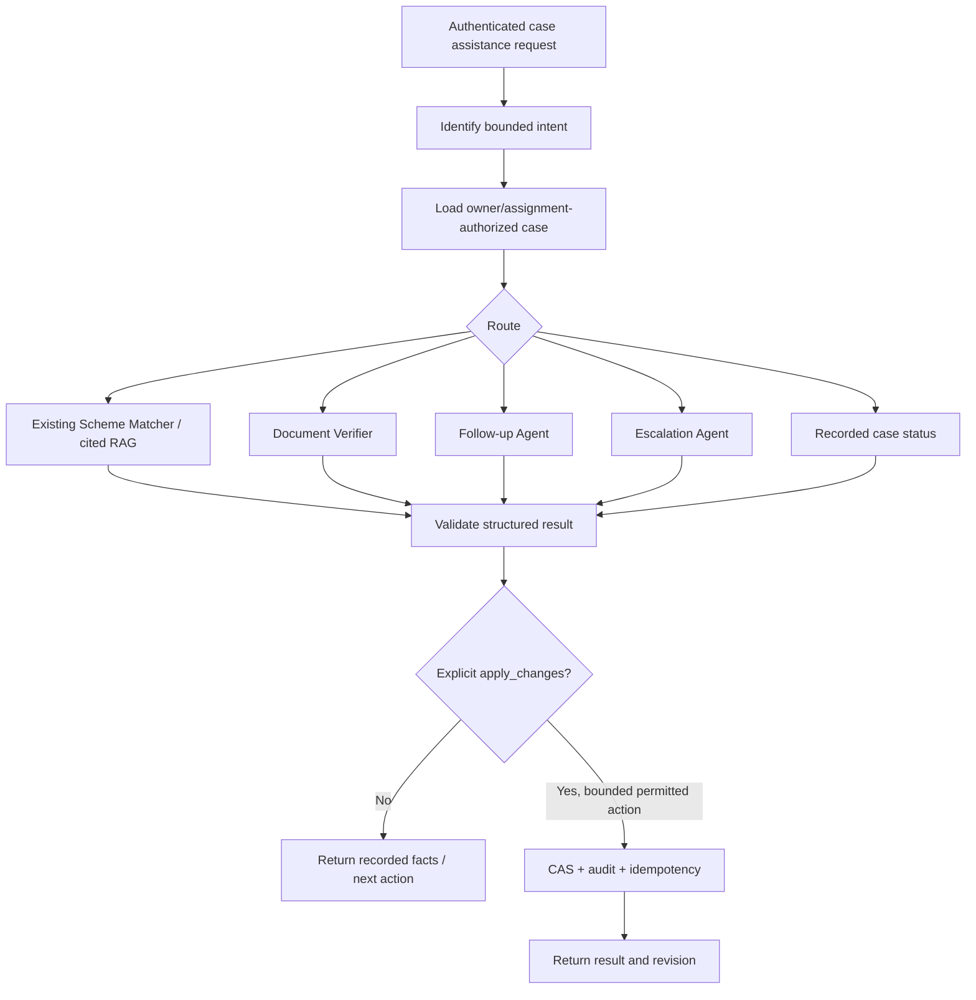

# Phase 3 — authenticated multi-agent case assistance

Implemented 17 November 2026 on the existing FastAPI/MongoDB/React/LangGraph system.
No official application submissions, KYC, government approval, paid messaging or
Phase 4 Doorstep Coordinator agent is implemented.

## What changed

- `app/auth.py`: provisioned identity, scrypt password verification, opaque sessions,
  session revocation, account lockout and sign-in throttling.
- `app/cases/`: typed shared cases, private storage, authorization, optimistic Mongo
  writes, durable automation, notification boundary, REST API, provisioning and worker CLIs.
- `app/agents/case_agents.py` and `case_orchestrator.py`: document, follow-up and
  escalation agents plus a bounded LangGraph router connected to the existing matcher.
- React auth provider, private dashboard, case page, document handling, case assistant
  and worker/coordinator/admin queues. Existing public discovery, Scheme Matcher,
  demo case tracking and doorstep request intake are retained.

## Identity and authorization

There is no public registration or user-selected role. A trusted local operator
provisions aliases using the CLI. Do not use real contact information as an alias.
Passwords are individually salted and hashed with scrypt; clear passwords are never
stored or returned. Login returns a random 256-bit bearer token. Mongo stores only
its SHA-256 digest and expiry. Roles and active-account state are checked from the
user record on every authenticated request. Logout removes the session immediately.
Eight-hour sessions are the default; Mongo TTL removes expired rows. Expiry checks
also run at authorization time, independently of TTL cleanup timing.

| Role | Scope and permissions |
| --- | --- |
| Citizen | Create own cases; view only owned cases; upload/download/delete owned files; schedule/acknowledge reminders; request internal human help |
| Worker | Only assigned cases and files; assist with uploads/follow-ups; no acceptance reviews, reassignment, closing or document deletion |
| Coordinator | Only assigned cases; human checklist review, stage/referral updates, notes; may explicitly claim an unassigned case for self |
| Admin | Authorized access to all cases; assign coordinators/workers and perform coordinator actions |

Unrelated case/file requests return 404 without disclosing existence. A coordinator's
unassigned queue contains only case ID, scheme ID, stage, revision and creation time.
Explicit confirmed self-claim is the one action that grants access from that queue.
Reassigning another coordinator's cases is admin-only. Staff targets must be active
provisioned accounts of the correct role. Closure/reopening and assignment require
explicit confirmation; closures/reopenings also require a reason.

Bearer tokens stay in React memory, not localStorage/sessionStorage or URL parameters.
Reloading the page clears the browser session; sign in again. In-app links preserve it.
Private API responses use Cache-Control: no-store. Validation errors omit raw input,
so passwords, notes and file bytes are not echoed. Five failed account logins trigger
a five-minute account lock; the default per-IP limit is ten login attempts/minute.
No raw questions, passwords, document contents or identity numbers belong in logs.

## Shared case record and lifecycle

`AssistanceCase` extends the prior case model and retains `scheme_id`,
`assistance_type`, `id`, `status`, and timestamps. Additional fields include:

- owner ID; assigned coordinator and workers; stage and resume stage;
- source-version snapshot, checklist, completeness flag and missing information;
- file hashes/metadata, technical results and human document reviews;
- durable follow-up schedules, delivered reminders and per-user acknowledgements;
- escalation reasons, severity, ownership, acknowledgement, resolution and reopen count;
- audit events, revision, last-human-activity time and next-automation time;
- quiet-hour preferences and minimal latest applied workflow trace.

```mermaid
stateDiagram-v2
    [*] --> DocumentsPending: owned case created
    Draft --> DocumentsPending
    DocumentsPending --> ReadyForHumanReview: verified checklist + human-accepted files
    ReadyForHumanReview --> AssistanceInProgress: coordinator action
    AssistanceInProgress --> WaitingForExternalUpdate: reported/internal milestone
    WaitingForExternalUpdate --> AssistanceInProgress
    AssistanceInProgress --> Completed: internal task completion
    WaitingForExternalUpdate --> Completed
    DocumentsPending --> OnHold
    AssistanceInProgress --> OnHold
    OnHold --> DocumentsPending
    DocumentsPending --> Escalated: internal human referral
    AssistanceInProgress --> Escalated
    Escalated --> DocumentsPending: all referrals resolved; resume saved stage
    Completed --> Closed: confirmed human closure
    Completed --> AssistanceInProgress: confirmed reopening
    DocumentsPending --> Closed: confirmed human closure
    Closed --> DocumentsPending: confirmed reopening
```



The service enforces the full transition table; the diagram shows primary paths.
`Completed`/`resolved` means the internal assistance task is finished, never that a
government application was approved. External updates are coordinator/user-reported
or unknown; no official status integration exists. Audit notes identify internal
versus explicitly reported external updates. Inactivity uses last human activity,
not scheduler writes, so background sweeps cannot make an idle case appear active.

Writes require the latest revision. Mongo replaces a case only when that revision
still matches; concurrent changes return 409. Mutation requests require an
Idempotency-Key. Reusing a key with changed action data returns 409. Replays of a
completed operation return the current case without duplicating its action. Owned
case creation has a unique owner/key index. Documents deduplicate by case, checklist
item and file hash; worker reminder writes use the same revision protection.

Cases have bounded histories (1,500 audit events, 1,200 mutation receipts, 50 file
history records, 500 follow-ups/reminders and 200 referrals). Capacity is rejected
explicitly rather than silently deleting audit history. A production archival
strategy remains necessary for larger/long-lived workloads.

## Four-agent orchestration



The case graph uses typed actor, case and request state. Routing is deterministic,
not model-selected arbitrary tool execution. The graph can answer document/status/
follow-up questions, request a human referral, or call the existing Scheme Matcher
with a user-bound conversation owner key. It never changes assignment or closes a
case; those are separately authorized, confirmed human endpoints. Document analysis
can advance only a fully reviewed checklist to the review stage. Applied follow-up
intent schedules one pending manual reminder; applied escalation creates/deduplicates
an internal referral. Read-only intents do not mutate the case. Only the last applied
intent/trace/actor/time is persisted, not the question or full prompt. Tracing is
explicitly disabled around graph execution.

Case agents are operational deterministic workflows; an LLM is not needed to know
which files/reminders are recorded. Optional LLM planning for scheme retrieval is
unchanged from Phase 2; no live LLM execution was introduced or claimed here.

## Document handling

Required items come from ingested verified-source `required_documents` plus supporting
`field_evidence`. Case creation snapshots source versions and checklist labels. Demo
requirements are explicitly marked unverified and cannot be accepted as official
checklists. Unknown requirements do not turn into an empty, “complete” checklist.
The current live PM-KISAN source still lacks a reviewed document list: cases for it
correctly require source review. No real government document requirement was invented.

The coordinator can refresh a checklist after a reviewed source is ingested. A source
version change invalidates existing human acceptances and requires review again.

Uploads are authenticated raw-body POST requests with a selected checklist item,
revision and Idempotency-Key. This avoids processing unbounded multipart fields or
retaining original filenames. Default limit: 10 MB. Content must match PDF/PNG/JPEG,
not just an extension or MIME declaration. PDFs must be readable by PyMuPDF,
unencrypted, 1–50 pages, without attachments or executable JavaScript/Launch actions.
PNG/JPEG decoding is allowlisted, capped at 20 million pixels, verified and rewritten
without EXIF metadata. Low resolution/contrast and scans without extracted text go
to human review. Technical extraction inspects only readability and never saves or
sends extracted text to a model. OCR is off by default; enabling it requires a local
Tesseract installation, and still retains only a readability result, not identity text.

Statuses include Received (audit event), Technically Readable, Unreadable, Missing,
Needs Human Review and Accepted for Assistance Checklist. Only a coordinator/admin
can assign the last status, with a review note. No result means legally authentic,
valid identity or official KYC. Workers cannot perform acceptance reviews.

`FileStorage` is provider-independent. LocalPrivateStorage uses random generated
filenames, exclusive writes, path validation and no public/static mount. Storage in
the frontend or Git metadata directory is rejected. File keys never appear in API
responses. Download rechecks case authorization and retention, forces attachment
download and sets nosniff/no-store/sandbox headers. Failed case writes remove newly
written orphan files. Use filesystem ACLs and disk encryption for local privacy;
application-level encryption, isolated parsers and malware scanning remain production
requirements. Format/quality checks are not antivirus or a legal authenticity check.

## Durable follow-ups and notifications

Follow-ups live inside the Mongo case, including reason, due time, status and creator.
The separate worker polls persisted due cases. A restart simply resumes overdue
schedules; no in-memory timer is the source of truth. Multiple sweeps/workers use
revision CAS, so only one stores a reminder for a follow-up. Delivery persists the
in-app record before emitting an optional ID-only development log.

Reasons: missing documents, coordinator review, appointment, manual and inactivity.
Schedules can be created by an authorized citizen/staff member. The worker repeats
missing-document follow-ups while required files are absent or unreadable. A pending
appointment remains visible even when notification delivery is deferred. Reminders
can be acknowledged by authorized users, and each acknowledgement is audited.

Default quiet hours are 21:00–08:00 Asia/Kolkata; equal start/end disables quiet hours.
The default minimum interval is 24 hours per case, including manual reminders.
Opting out defers delivery while leaving schedules visible. Quiet hours/frequency
can delay an appointment notification; this is not an emergency alert service.
Notification text is generic and contains no identity information or document text.
Only in-app persistence/development logging is implemented. Future SMS/WhatsApp
providers must implement the notification boundary and obtain separate consent.

## Escalations

Deterministic triggers: explicit human-help request; seven days without human
activity; three missing-document reminders while items remain missing; document
review unresolved for 48 hours; or a coordinator conflict flag. Thresholds are
environment-configurable. Reasons have normal/high severity and an authorized
coordinator owner (or explicitly await assignment). An active reason is deduplicated.
Coordinators acknowledge, resolve with notes and reopen referrals. Resolution
restores the saved assistance stage once every active referral is resolved. Persistent
conditions can create a new episode after the configurable 24-hour cooldown.
This is internal human referral, never an automatic government complaint.

## Retention and deletion

Files expire after 30 days by default; access is denied immediately at expiry even
if the cleanup worker is offline. Confirmed document deletion blocks access and
removes content; retryable cleanup reconciles deletion metadata. Minimal hashes and
audit events remain within the case until case retention expires. `--purge-expired`
removes expired/deleted file content and removes closed cases after 180 days.
Closed-case purging claims the case with a revision change and blocks reopening
before deleting files. Retention intervals are configurable. Keep the worker running
for physical cleanup. Backups, replicas, logs and formal data-subject erasure need
separate operational policies; this is not a complete regulatory compliance system.

## API reference

All private operations require Authorization: Bearer TOKEN. Mutation bodies contain
`revision`; requests carry a unique `Idempotency-Key`. The preference endpoint takes
revision in the query. Document upload uses raw PDF/image bytes, item_id and revision
query parameters. Source discovery remains public; private case routes never accept
a Phase 1 development token as citizen identity.

| Method / path | Purpose |
| --- | --- |
| POST /api/auth/login; POST /api/auth/logout; GET /api/auth/me | Sessions |
| POST /api/cases; GET /api/cases; GET /api/cases/{id} | Owned/assigned case creation, list and detail |
| GET /api/cases/{id}/checklist; GET /api/cases/{id}/activity | Checklist analysis and paginated timeline |
| POST /api/cases/{id}/stage; POST /api/cases/{id}/assignment | Authorized stage/assignment changes |
| POST /api/cases/{id}/documents | Private upload |
| GET /api/cases/{id}/documents/{doc}/content | Authorized attachment download |
| POST /api/cases/{id}/documents/{doc}/review or /delete | Human review / confirmed deletion |
| POST /api/cases/{id}/checklist/refresh | Refresh reviewed requirements/version |
| POST /api/cases/{id}/followups; POST /api/cases/{id}/preferences | Schedule/preferences |
| POST /api/cases/{id}/reminders/{reminder}/acknowledge | Reminder acknowledgement |
| POST /api/cases/{id}/assist | Read-only or explicitly applied bounded graph task |
| POST /api/cases/{id}/escalations/{escalation}; POST /api/cases/{id}/flags | Human escalation workflow |
| GET /api/coordinator/queue; GET /api/coordinator/staff | Staff queues / assignment targets |

Queues support page (1+) and limit (1–50), kind cases/reviews/followups/escalations/
unassigned; case lists also support stage. Unassigned queue is coordinator/admin-only.
400/422 indicates invalid input, 401 an invalid session, 403 a role restriction, 404
no authorized object, 409 a stale revision/invalid transition, 410 an expired file,
413 an oversized file and 415 an unsupported format. Workflow timeouts return 504;
Mongo availability errors return safe 503 responses.

Legacy Phase 1 token-only create/get routes continue to use the separate `cases`
collection in explicitly enabled local development. They cannot fetch the new
`assistance_cases`, documents or profiles. New signed-in cases use the same case
URLs with bearer identity. Anonymous demo tracking remains a separate workflow.
Disable ENABLE_DEV_CASE_ACCESS outside legacy local demonstrations. Authentication
does not migrate or guess ownership of old demo records.

## Windows PowerShell setup

Prerequisites remain Python 3.12, Node 22.12+ and local MongoDB. From repository root:

```powershell
cd backend
.\.venv\Scripts\python.exe -m pip install -r requirements.lock.txt
if (!(Test-Path .env)) { Copy-Item .env.example .env }
# Provision each required role. Passwords are prompted, never command-line arguments.
.\.venv\Scripts\python.exe -m app.cases.cli --username local-citizen --role citizen
.\.venv\Scripts\python.exe -m app.cases.cli --username local-coordinator --role coordinator
.\.venv\Scripts\python.exe -m app.cases.cli --username local-worker --role worker
.\.venv\Scripts\python.exe -m app.cases.cli --username local-admin --role admin
.\.venv\Scripts\python.exe -m uvicorn app.main:app --reload --host 127.0.0.1 --port 8000
```

In another backend terminal run the durable worker:

```powershell
cd E:\YojanaSetu\YojanaSetu\backend
.\.venv\Scripts\python.exe -m app.cases.worker --purge-expired
# A single sweep for development:
# .\.venv\Scripts\python.exe -m app.cases.worker --once --purge-expired
```

In a frontend terminal:

```powershell
cd E:\YojanaSetu\YojanaSetu\frontend
npm ci
npm run dev
```

Open http://localhost:5173/login. This machine also supports the bundled Node/npm
fallback documented in phase2.md. Authentication and deterministic case agents do
not need a model or API key. Scheme-matching intent requires ENABLE_AI and the
existing Chroma/embedding configuration. No doorstep worker dispatch is connected.

Relevant settings are in `.env.example`: session/login limits, private storage path,
file bytes/retention, closed-case retention, OCR flag, follow-up frequency, inactivity,
unresolved-review threshold, missing-reminder threshold and escalation cooldown.

## Testing

```powershell
# From backend, with MongoDB running:
$env:MONGO_TEST_URI='mongodb://127.0.0.1:27017'
.\.venv\Scripts\python.exe -m pytest -q
.\.venv\Scripts\python.exe -m ruff check .
.\.venv\Scripts\python.exe -m ruff format --check .
.\.venv\Scripts\python.exe -m pip check
.\.venv\Scripts\python.exe -m scripts.verify_phase3_browser
# Original browser regressions, if Chrome is installed:
.\.venv\Scripts\python.exe -m scripts.verify_browser
.\.venv\Scripts\python.exe -m scripts.verify_phase2_browser
# From frontend:
npm test
npm run lint
npm run build
```

The new Chrome check uses ports 5176/8003 and isolated, explicitly synthetic users,
scheme/checklist fixtures and files. It deletes only its generated database/files
afterward. Set NODE_BINARY/CHROME_BINARY if tools are not on PATH. Tests do not
depend on paid models. The full live knowledge base is not populated with synthetic
verified government schemes by these tests.

## Before production

Obtain stronger identity assurance/role provisioning, password reset and MFA,
HTTPS, shared rate limits for authenticated mutations, account administration,
security review, dependency scanning, encrypted storage/backups and audited storage
ACLs. Isolate PDF/image/OCR parsers and add antivirus/content-disarm scanning.
Add monitoring, database backup/restore checks, scheduler supervision, audit archival
and retention reconciliation. Login limits are in-process per IP plus durable
per-account lockout; a gateway/shared limiter is needed for multiple API workers.
No claim of production readiness, legal identity verification or regulatory
compliance is made. English is implemented; Hindi/Telugu remain labelled previews.
The current official source catalogue is still partial, and no live LLM test is
claimed. Stop here: Doorstep Coordinator belongs to Phase 4.
