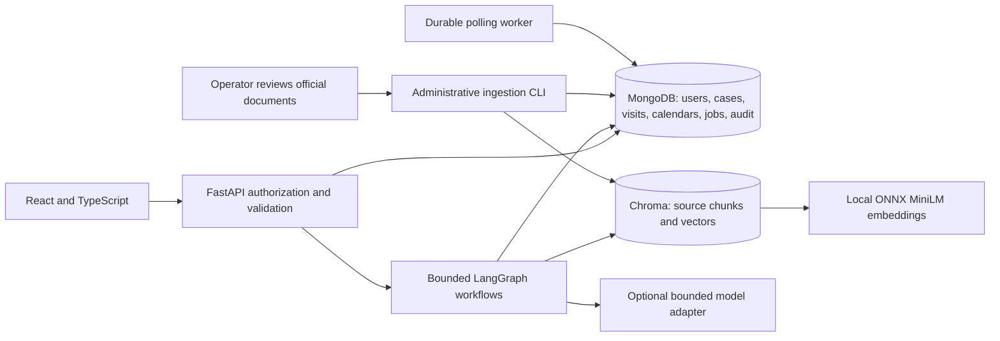
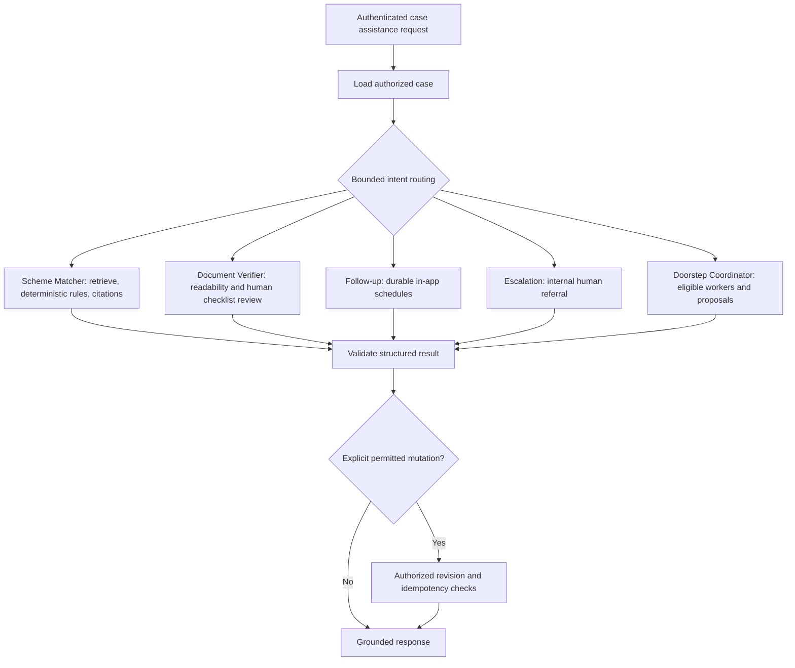
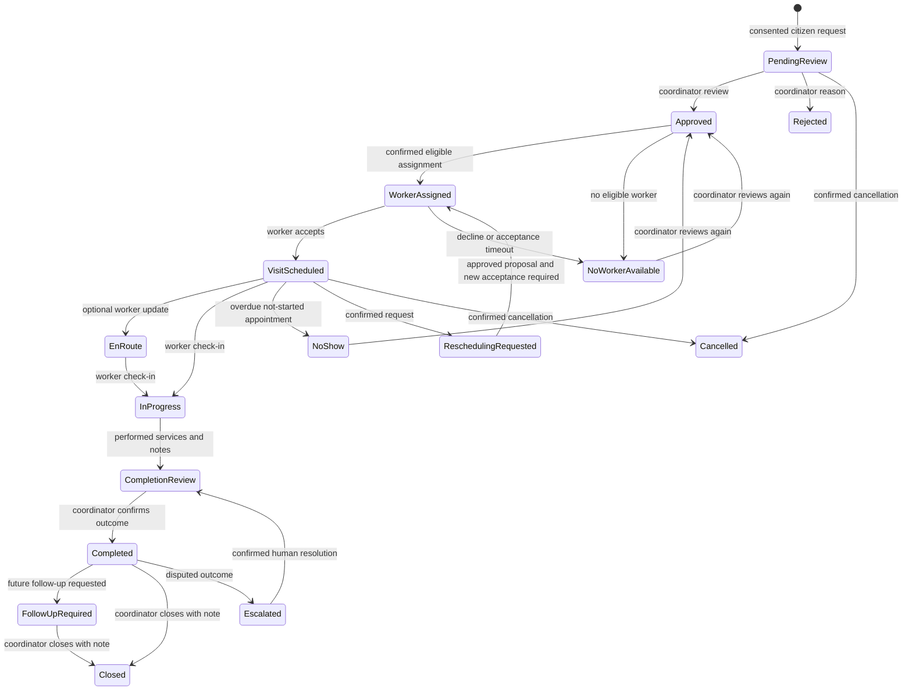
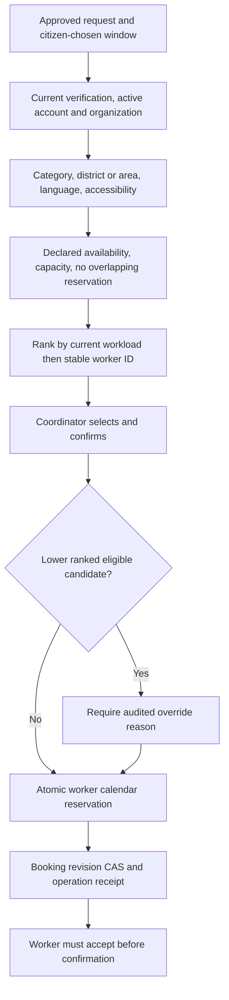
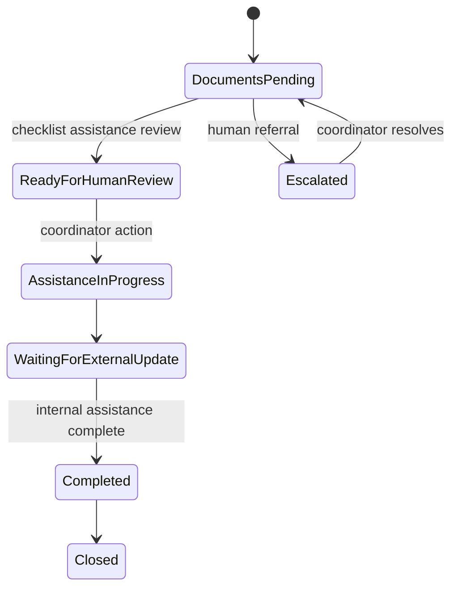

# Phase 4 implementation and local operation

YojanaSetu discovers source-backed welfare information. SevaSetu coordinates internal
in-person assistance. Neither service performs official KYC, government approval,
government application submission or verified MeeSeva partnership.

## Architecture



MongoDB is the authority for permissions, active source versions and application
state. Chroma serves semantic search, not citizen records or authorization decisions.
Typed graph state is ephemeral; durable domain records, operation receipts, audit
history, reminders and the case completion outbox provide retry state. There is no
general autonomous tool executor or circular agent loop.

## Five agents and orchestration



Scheme matching preserves its eight-node RAG graph and independent session memory.
Document verification never establishes identity/authenticity. Missing checklist
items can suggest a consented document-assistance visit. Doorstep guidance linked
to a case checks both request authorization and case ownership. Its graph checks
consent, eligibility and availability, ranks candidates, proposes a visit, gates
assignment, evaluates escalations and returns grounded guidance. Assignment uses
the same service method as the coordinator API. It never verifies workers.

The background worker reuses Follow-up quiet-hour logic and Escalation-style
deduplication. Reviewed doorstep completion adds one generic authorized case
activity event through an outbox receipt; it does not change official case status.

## Visit lifecycle



This diagram shows common paths; the service checks every action's role, stage,
confirmation and input requirements. Cancellation/rescheduling cannot rewrite a
started or reviewed visit. Use problem reporting and follow-up instead. A citizen
rescheduling an unreviewed request cannot bypass initial coordinator approval.
Sharing withdrawal revokes an active assignment; changing service language also
requires eligibility review again. Worker access to terminal requests is denied.

## Assignment and calendar authority



An override cannot bypass eligibility, suspension, availability or conflicts. A new
time outside the preferred window requires a citizen-confirmed reschedule first.
All timestamps have explicit offsets, are normalized to UTC seconds and are shown
in Asia/Kolkata. A reservation is one atomic worker document update, so standalone
MongoDB still prevents overlapping appointments. Booking updates use revision CAS.

The two documents are not one transaction: a crash can conservatively leave a
reservation. The polling worker releases it only when booking revision/state proves
the pending update cannot commit. It does not blindly expire in-flight reservations.
This may temporarily reduce availability; it avoids speculative double booking.

## Existing citizen case lifecycle



Case and visit states are distinct. Neither is an external department's approval.

## MongoDB records and indexes

| Collection | Purpose and constraints |
| --- | --- |
| users / sessions | Provisioned role accounts; scrypt hashes; hashed opaque sessions with expiry |
| assistance_cases | Ownership, assigned staff, checklist, private document references, reminders, audit and operation receipts |
| seva_requests | Unique request ID and owner/creation-key pair; revisions, explicit approval, consent, appointments, outcome, notices, escalation and outbox flag |
| seva_workers | Unique worker ID; reviewed profile, expiry, declared availability and atomic reservations |
| seva_organizations | Unique organization ID, active/internal review state, reviewer and audit |
| seva_rate_limits | Per-account minute admission counters with TTL cleanup |
| ai_sources / ai_source_versions | Active reviewed metadata and immutable version metadata going forward |
| ai_conversations | Session-owned minimal profile and scheme IDs; TTL; no raw transcript |

Visit owner, assigned worker, claimed coordinator, stage and automation time are
indexed. Sensitive file content stays in private storage, never a public static path.

## API guide

All `/api/seva` routes require an individual bearer session and rate admission.
Mutating visit actions require `Idempotency-Key` and current `revision`; retries
must keep the same key and payload. A stale revision or changed replay is HTTP 409.
Profile/calendar/verification/organization changes use revision CAS. Creation keys
are owner-scoped. Authorization failures do not reveal other citizens' objects.

| Method and path | Purpose / authority |
| --- | --- |
| POST /api/auth/login, /logout; GET /api/auth/me | Individual session lifecycle |
| POST /api/seva/requests | Citizen creates own request |
| GET /api/seva/requests | Paginated authorized list; stage filter; minimal unclaimed staff queue |
| GET /api/seva/requests/{id} | Owner, assigned currently verified worker, claimed coordinator or admin |
| POST /api/seva/requests/{id}/actions | Explicit lifecycle action, outcome, review, feedback, problem or follow-up |
| POST /api/seva/requests/{id}/assignment | Confirmed coordinator/admin assignment of an eligible worker |
| POST /api/seva/requests/{id}/agent | JSON null for read-only guidance; explicit Assignment for gated mutation |
| POST /api/seva/requests/{id}/preferences | Owner sharing, service/notice language, in-app consent and quiet hours |
| POST /api/seva/requests/{id}/notifications/{notice}/acknowledge | Authorized acknowledgement of a delivered notice |
| POST /api/seva/workers/{id} | Worker/coordinator own profile, or admin; starts pending verification |
| GET /api/seva/workers; GET /api/seva/workers/{id} | Paginated staff directory or own profile; verification filter |
| POST /api/seva/workers/{id}/profile | Material edit resets verification; held future visits block eligibility edits |
| POST /api/seva/workers/{id}/availability | Worker or admin declares/removes windows; reserved slots cannot be removed |
| POST /api/seva/workers/{id}/verification | Admin only, explicit confirmation and review note; future expiry for positive verification |
| POST /api/seva/organizations | Admin records organization; staff list via GET |
| POST /api/seva/organizations/{id}?revision=N | Confirmed administrator edit, including activation/deactivation |
| POST /api/cases/{id}/assist | Case agents, optional linked `doorstep_request_id`; read-only by default |
| GET /api/ai/coverage | Public reviewed source coverage, missing fields, freshness, duplicates and potential conflicts |
| GET /api/ai/schemes/{id}/sources | Reviewed source metadata |

The interactive schemas at `http://127.0.0.1:8000/docs` describe all required fields,
including the preserved Phase 1–3 routes. Production exposure of API docs requires
an explicit deployment decision.

## Worker verification and privacy

Workers submit display name, affiliation, categories, languages, coverage,
capabilities, qualifications and capacity. Only administrators approve internal
verification, confirmed authorization, suspension or expiry. Positive verification
requires an expiry; confirmed authorization also requires a reviewed HTTPS evidence
URL. That is an operator attestation, not automated government accreditation.
Material profile edits reset verification. Active reservations block material edits.

Workers cannot browse citizen directories or unassigned requests. Exact location is
withheld before acceptance and outside active visit stages; cancelled/closed/rejected
visits are unavailable to workers. Citizens see the assigned display name, not private
worker contacts. Map coordinates are optional API fields with explicit consent; the
UI neither requests device location nor tracks location histories. No visit photos
or identity documents are required. Retention redacts visit addresses and free-text
outcomes/audit notes after the configured terminal retention period.

## LLM configuration and grounding

Current verified mode: `LLM_PROVIDER=none`, local ONNX embeddings and evidence-only
RAG. No Ollama server was reachable on loopback port 11434 during verification.
Live LLM inference is **unverified**. Mocked tests cover Ollama and OpenAI-compatible
protocols, bounded retries, malformed/oversized output, approval gates and fallback.

Optional local configuration: `LLM_PROVIDER=ollama`, `LLM_MODEL=qwen2.5:3b`,
`MODEL_BASE_URL=http://127.0.0.1:11434`. Install and run a local model separately if
desired; none is downloaded by this implementation. Hosted configuration remains
blocked by `ALLOW_HOSTED_LLM=false`. Do not enable it or supply paid credentials
without separate explicit approval. ChatGPT subscriptions do not provide API credit.

Limits: model timeout 45 seconds, output 512 tokens, input 16000 characters, output
16000 characters, one retry; all configurable within validated bounds. Response
bytes are bounded while reading. Model output cannot invoke tools. Scheme explanations
select existing citation IDs; case/checklist/coordinator/doorstep summaries select
authorized fact IDs. Unknown IDs or model-authored claims fall back to deterministic
facts. No free-form legal translation or unsourced benefit generation is used.

## Sources and multilingual status

The local index contains three real partial sources: PM-KISAN portal, Department of
Financial Services PMSBY FAQ, and Telangana ePASS Kalyana Lakshmi services page.
Manifests are in `backend/sources`; local database/vectors and downloaded snapshots
are ignored by Git. PMSBY has reviewed preliminary age checks. Telangana has no
automated eligibility thresholds because category and rural/urban context are not
represented in the citizen profile. Its official registration link was inspected
with GET only. Publication date is unknown for that portal; do not invent one.

Ingestion validates official HTTPS domains, quote presence, numeric rule evidence,
content hashes and versions. Application URLs need a dated manual link review and
evidence. Repeat ingestion detects unchanged versions. Coverage flags duplicate
content and differing reviewed thresholds for human reconciliation. Multiple sources
never silently produce a combined positive eligibility decision. Old version metadata
is retained; this is not a complete archive of historical government documents.

English, Hindi and Telugu navigation dictionaries have key-parity tests and a
persisted language preference. Notifications have language-aware generic templates.
Most forms and all government rule explanations remain English, visibly labelled
as partial language support. Numeric/legal conditions are not machine-translated.
Speech input/output is not implemented.

## Notifications and operations

One polling worker handles case and visit jobs. Visits have durable assignment,
confirmation, rescheduling, cancellation, reminder, missed-visit, escalation,
completion and follow-up notices. Notice keys and operation receipts prevent
duplicate actions. Delivery respects in-app preferences, India-time quiet hours
and configured frequency. Acknowledgements are durable. Messages are generic and
contain no address, document contents, Aadhaar or account data. External SMS and
WhatsApp adapter contracts deliberately reject sending; no paid transport exists.

The worker must run for delivery, acceptance timeout, missed-visit handling, outbox
sync and retention cleanup. A successful API response is not external message
delivery. Changes may require refresh; no push notification transport is configured.

## Exact Windows commands

From `E:\YojanaSetu\YojanaSetu`, start the existing portable MongoDB if port 27017
is not already listening (do not start a second process against the same data):

```powershell
$mongoBinary=(Get-ChildItem .tools/mongodb -Recurse -Filter mongod.exe | Select-Object -First 1).FullName
Start-Process -FilePath $mongoBinary -ArgumentList '--dbpath','E:\YojanaSetu\YojanaSetu\.tools\mongodata','--bind_ip','127.0.0.1','--port','27017','--logpath','E:\YojanaSetu\YojanaSetu\.tools\mongodb.log','--logappend' -WindowStyle Hidden
Set-Location backend
# Preserve an existing .env. Use .env.example only if creating a fresh configuration.
if (-not (Test-Path .env)) { Copy-Item .env.example .env }
.\.venv\Scripts\python.exe -m app.cases.cli --username local-citizen --role citizen
.\.venv\Scripts\python.exe -m app.cases.cli --username local-worker --role worker
.\.venv\Scripts\python.exe -m app.cases.cli --username local-coordinator --role coordinator
.\.venv\Scripts\python.exe -m app.cases.cli --username local-admin --role admin
# Provision each alias only once. Passwords are prompted securely.
.\.venv\Scripts\python.exe -m uvicorn app.main:app --host 127.0.0.1 --port 8000
```

In a second terminal:

```powershell
Set-Location E:\YojanaSetu\YojanaSetu\backend
.\.venv\Scripts\python.exe -m app.cases.worker --purge-expired
```

In a third terminal:

```powershell
Set-Location E:\YojanaSetu\YojanaSetu\frontend
$env:PATH='C:\Users\dhroo\.cache\codex-runtimes\codex-primary-runtime\dependencies\node\bin;' + $env:PATH
node ..\.tools\package\bin\npm-cli.js run dev
```

Open `http://localhost:5173/login`, then SevaSetu. Browser reload clears the memory-only
session and requires signing in again. There is no public role selector or registration.
For a fresh installation, use the dependency/setup sections in the root README first.

Environment: `MONGODB_URI`, `MONGODB_DATABASE`, `CORS_ORIGINS`, private
`DOCUMENT_STORAGE_PATH`, and frontend `VITE_API_BASE_URL` configure the core app.
`ENABLE_AI=true`, ONNX settings and `CHROMA_PATH` enable local RAG. The legacy development
AI routes also require explicit `ENABLE_DEV_CASE_ACCESS=true`, a random 32+ character
`DEV_ACCESS_TOKEN`, and independent browser session key. SevaSetu uses individual login,
not this shared development token. All defaults/limits are in `backend/.env.example`.

## Tests and deployment prerequisites

```powershell
Set-Location E:\YojanaSetu\YojanaSetu
$env:MONGO_TEST_URI='mongodb://127.0.0.1:27017'
.\backend\.venv\Scripts\python.exe -m pytest backend/tests -q
.\backend\.venv\Scripts\python.exe -m ruff check backend/app backend/tests backend/scripts
.\backend\.venv\Scripts\python.exe -m ruff format --check backend/app backend/tests backend/scripts
.\backend\.venv\Scripts\python.exe -m pip check
Set-Location backend
$env:NODE_BINARY='C:\Users\dhroo\.cache\codex-runtimes\codex-primary-runtime\dependencies\node\bin\node.exe'
.\.venv\Scripts\python.exe -m scripts.verify_browser
.\.venv\Scripts\python.exe -m scripts.verify_phase2_browser
.\.venv\Scripts\python.exe -m scripts.verify_phase3_browser
.\.venv\Scripts\python.exe -m scripts.verify_phase4_browser
.\.venv\Scripts\python.exe -m scripts.verify_phase2
Set-Location ../frontend
$env:PATH='C:\Users\dhroo\.cache\codex-runtimes\codex-primary-runtime\dependencies\node\bin;' + $env:PATH
node ..\.tools\package\bin\npm-cli.js test
node ..\.tools\package\bin\npm-cli.js run lint
node ..\.tools\package\bin\npm-cli.js run build
```

See the completion report for executed results. Synthetic accounts/documents are
isolated in disposable databases; browser scripts stop their temporary servers.

Before production: managed authenticated MongoDB, encrypted backups and tested restore,
private encrypted object storage, TLS, deployment-specific CORS, real account onboarding
and recovery, staff verification governance, monitoring, resilient job operations,
multi-instance load/failure testing, independently reviewed privacy/security policy,
current comprehensive government sources and reviewed translations. Large directories
need a more scalable candidate query (currently bounded to 500 profiles); organization
listing is bounded to 100. This local verification is not a production penetration
test or a distributed reliability certification. Nothing has been deployed or pushed.
